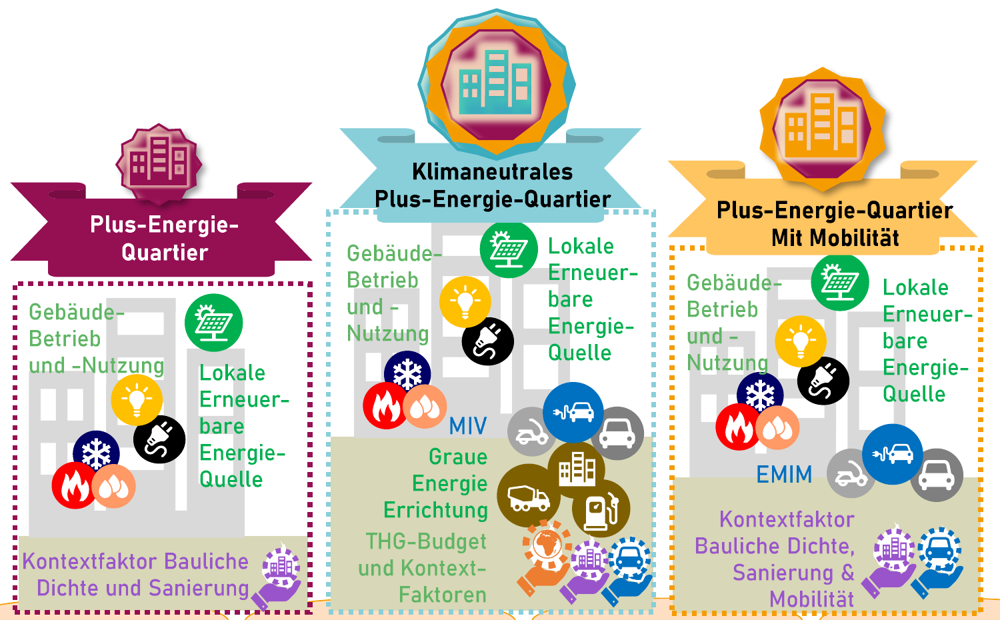

PEExcel · Positive Energy Districts
<h1>Turn district designs into transparent assessments.</h1>
Hourly simulation and comparative assessment of buildings, energy supply and mobility for the klimaaktiv declaration.

<a href="start.qmd">Tool use</a><a class="secondary" href="../index.html">Deutsch</a>

PEExcel is an Excel-based modelling and assessment tool developed by the **Climate-fit Buildings and Districts** research group at [FH Technikum Wien](https://www.technikum-wien.at/). It supports professional competency partners, designers, consultants, researchers and students.

## Explore the tool

🏙️<h3>Model</h3>
Connect buildings, uses, envelope and building services. <a href="model.qmd">District modelling →</a>

🌞<h3>Analyse energy</h3>
Review heat, cooling, PV, storage and grid interaction. <a href="systems.qmd">Energy flows →</a>

☁️<h3>Assess results</h3>
Compare energy, mobility and life-cycle impacts. <a href="examples.qmd">Example results →</a>

## What can you explore?

- Hourly energy balances for heating, cooling, electricity, hot water, ventilation and auxiliary energy.
- Photovoltaics, self-consumption, grid interaction, storage and flexibility.
- Location-dependent mobility and life-cycle greenhouse gas emissions.
- Scenario comparisons, structured input/output tables and Python analysis with `pexl`.

## Three assessment levels

The klimaaktiv framework distinguishes a Positive Energy District, a Positive Energy District with mobility, and a climate-neutral Positive Energy District including life-cycle greenhouse gas emissions.

**The Excel interface and detailed tutorials are in German.** This English section provides translated guidance; workbook worksheet and ribbon names remain in German where needed to identify the controls.

[Downloads](download.qmd) · [Technical documentation](learn.qmd) · [Research](research.qmd) · [About](about.qmd)

## Modelling and declaration

The model permits alternative assumptions. A klimaaktiv declaration must use the specified declaration values and assessment rules. PV life-cycle emissions can be modelled but are excluded from the current klimaaktiv assessment method. The distinction between modelling freedom and mandatory declaration inputs also applies to hourly conversion factors, plug loads and internal heat gains.

The [building section](envelope.qmd) illustrates model boundaries and qualitative heat flows. The [three refurbishment variants](examples.qmd) provide annual heat, final-energy, primary-energy and GHG comparisons. [Aspern F7](examples.qmd#aspern-f7) provides a separate hourly electrical-flow example; export completeness is stated explicitly.
