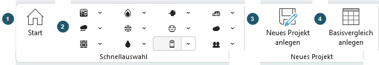
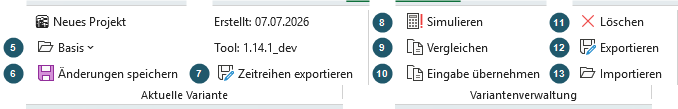
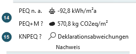
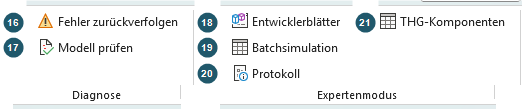
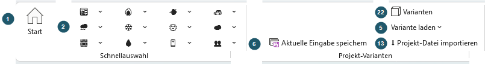

PEXL is organised into input groups, calculation and evaluation. Thematic technical sheets hold the main settings; additional sheets store variants, simulate and present results.

{.manual-figure}

## Main areas

- **Inputs:** project, buildings, energy supply, mobility and LCA.
- **Calculation and variants:** saved inputs, simulations and variant management.
- **Analysis and verification:** results, dashboard, comparison, declaration and audit sheets.

The overview below locates settings and links to their explanations. Original worksheet names remain visible to match the German workbook.

## Ribbon overview {#menueband}

Use the ribbon to choose presets, manage variants and check results. The numbers below refer to the command table. German labels match the workbook.

### Official release 1.13.3 {#ribbon-133}

From left to right, the ribbon provides **Start** and **Schnellauswahl** (home and presets, 1–2), **Neues Projekt** (new project, 3–4), **Aktuelle Variante** (current variant, 5–7), **Variantenverwaltung** (variant management, 8–13) and **Nachweis** (verification, 14–15). The current variant group also displays the project name, creation date and tool version.

The following sections are taken from 1.14.1_dev and show the controls shared with release 1.13.3.

{.manual-figure}

{.manual-figure}

{.manual-figure}

### Other versions

::: {.callout-note collapse="true" #ribbon-dev}
## 1.14.1_dev – diagnostics and expert mode

{.manual-figure}

Two additional groups appear to the right of **Nachweis** in this development version. **Diagnose** contains the error tracing and model checks (16–17). **Expertenmodus** provides access to developer worksheets, batch simulation, the log and greenhouse gas components (18–21).
:::

::: {.callout-note collapse="true" #ribbon-127}
## 1.12.7 – project variants

{.manual-figure}

After **Start** and **Schnellauswahl** (1–2), the **Projekt-Varianten** group contains **Varianten** (22), **Variante laden** (5), **Aktuelle Eingabe speichern** (6) and **Projekt-Datei importieren** (13). The project and variant names depend on the loaded variant.
:::

### Ribbon commands and indicators

| No. | Workbook label | What it does | Version note |
|---:|---|---|---|
| 1 | Start | Go to the start sheet. |  |
| 2 | Schnellauswahl | Open an icon menu and choose a [preset](presets.qmd) for that input group. |  |
| 3 | Neues Projekt anlegen | Create a project. |  |
| 4 | Basisvergleich anlegen | Set up a baseline comparison for the project. |  |
| 5 | Variante auswählen | Open the dropdown showing the current variant name and select a saved variant to load. | **Variante laden** in [1.12.7](#ribbon-127). |
| 6 | Änderungen speichern | Save the current inputs for the variant. | **Aktuelle Eingabe speichern** in [1.12.7](#ribbon-127). |
| 7 | Zeitreihen exportieren | Export the time series for the current variant. |  |
| 8 | Simulieren | Run the [simulation](variants.qmd). |  |
| 9 | Vergleichen | [Compare results](comparison.qmd) across variants. |  |
| 10 | Eingabe übernehmen | Transfer inputs to the variant manager. |  |
| 11 | Löschen | Remove a variant from the project. |  |
| 12 | Exportieren | Export variant data for sharing. |  |
| 13 | Importieren | Import variant data from a project file. | **Projekt-Datei importieren** in [1.12.7](#ribbon-127). |
| 14 | Nachweis | Read the PEQ, PEQ+M and KNPEQ status indicators alongside the calculated values. |  |
| 15 | Deklarationsabweichungen | Review deviations relevant to the [declaration](declaration.qmd). |  |
| 16 | Fehler zurückverfolgen | Trace a model error to its source. | [1.14.1_dev](#ribbon-dev) only. |
| 17 | Modell prüfen | Run the model check. | [1.14.1_dev](#ribbon-dev) only. |
| 18 | Entwicklerblätter | Open the worksheets used for model development. | [1.14.1_dev](#ribbon-dev) only. |
| 19 | Batchsimulation | Open [batch simulation](batch.qmd) to run multiple variants. | [1.14.1_dev](#ribbon-dev) only. |
| 20 | Protokoll | View the log. | [1.14.1_dev](#ribbon-dev) only. |
| 21 | THG-Komponenten | Open the greenhouse gas components. | [1.14.1_dev](#ribbon-dev) only. |
| 22 | Varianten | Open the variant overview. | Appears in [1.12.7](#ribbon-127). |

## Sheet navigator

| Excel sheet | Description and guide |
|---|---|
| [▶]{.excel-menu .darkred} **Quick Start** | [Getting started](excel-overview.qmd) and [presets](presets.qmd) |
| [🏙]{.excel-menu .darkred} **Quartier** | [Project, areas and location](model.qmd#quartier-eingeben) |
| [🌦]{.excel-menu .darkred} **Wetter** | [Weather data](interfaces.qmd#wetter) |
| [🧱]{.excel-menu .darkred} **Bauphysik** | [Envelope and thermal mass](envelope.qmd#excel-bauphysik) |
| [🔥H]{.excel-menu .darkred} **Heizung** | [Heating](hvac.qmd#heizung) |
| [❄K]{.excel-menu .darkred} **Kühlung** | [Cooling](hvac.qmd#kuehlung) |
| [💧WW]{.excel-menu .darkred} **Warmwasser** | [Hot water](hvac.qmd#warmwasser) |
| [💨L]{.excel-menu .darkred} **Lüftung** | [Ventilation](hvac.qmd#lueftung) |
| [🌞 PV]{.excel-menu .darkred} **Photovoltaik** | [Photovoltaics](pv.qmd) |
| [PV-Import]{.excel-menu .darkred} | [Importing hourly profiles](pv.qmd#profilimport) |
| [🔋]{.excel-menu .darkred} **Flexibilität und Speicher** | [Configure storage](systems.qmd) and [analyse flexibility](flexibility.qmd) |
| [🚗]{.excel-menu .orange} **Mobilität** | [Model mobility](mobility.qmd) and [analyse behaviour](mobility-analysis.qmd) |
| [☁ THG]{.excel-menu .teal} **Graue Emissionen, Ökobilanz** | [LCA](climate.qmd) |
| [👤]{.excel-menu .darkred} **Nutzungsparameter** | [User electricity and internal gains](usage.qmd) |
| [📊 Erg]{.excel-menu .red} **Ergebnisse** | [Results and indicators](results.qmd) |
| [📈]{.excel-menu .red} **Dashboard** | [Hourly charts](excel-dashboard.qmd) |
| [🔎 var]{.excel-menu .red} **Variantenvergleich** | [Variant comparison](comparison.qmd) |
| [Scen]{.excel-menu .red} | [Batch simulation](batch.qmd) |
| [PEQ]{.excel-menu .darkred} | [Verify operational balance](declaration.qmd#excel-nachweise) |
| [PEQ+M]{.excel-menu .orange} | [Include mobility](declaration.qmd#excel-nachweise) |
| [KN PEQ]{.excel-menu .teal} | [Assess life cycle](declaration.qmd#excel-nachweise) |
| [AUDIT]{.excel-menu .red} | [Quality assurance](declaration.qmd#qualitaetssicherung) |

**IN**, **OUT** and **SIM2** are internal data areas for inputs, results and hourly simulations. Distinguish them from the visible **Erg** results sheet.

## How the guides are structured

The website uses consistent notation for Excel locations, fields and actions.

| Notation | Meaning |
|---|---|
| [🔥H]{.excel-menu .darkred} **Heizung** | Worksheet or menu |
| [Maximale Heizleistung]{.excel-field} | Specific field: maximum heating capacity |
| [Aktuelle Eingabe speichern]{.excel-action} | Action: save current inputs |
| [“Fernwärme Wien”]{.excel-value} | Selected preset: district heating |
| [Heizsysteme]{.excel-section} | Thematic section: heating systems |

Operating instructions are highlighted as **Where in PEXL?** Start with [getting started](excel-overview.qmd), then build a typical configuration using [presets](presets.qmd).

Source: [PEXL training, slides 25, 28 and 30](../downloads/schulung.pdf#page=25) (German).
