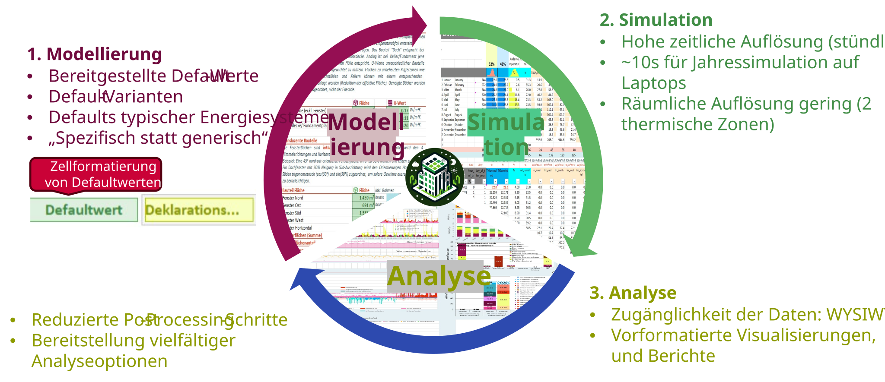

PEExcel is the calculation and verification tool for the klimaaktiv standard for positive energy districts. It connects building operation, energy supply, motorised private mobility and life-cycle emissions in an hourly assessment model.

Use Excel to investigate and calculate project variants and compare their energy and greenhouse gas balances.

## The workflow at a glance

Work follows a recurring sequence:

{.manual-figure}

Starting from a project description, define inputs and measures, calculate and check results. Then adjust variants and compare them.

## Five steps to your first evaluation

### 1. Download and open the Excel tool

Download the current [Excel tool](download.qmd), save it locally and open it in Microsoft Excel. Enable macros for advanced operation and variant functions. Keep an unchanged starting file for your own projects.

### 2. Define the project and baseline variant

::: {.excel-operation}
**Where in PEExcel?** Sheet [▶]{.excel-menu .darkred} (**Quick Start**).

Select the basic project and geometry parameters. Alternatively, [load a saved variant](variants.qmd).
:::

**Quick Start** provides quick access to the main model settings.

{.manual-figure}

### 3. Set the configuration

Choose suitable [presets](presets.qmd), for example for the envelope, heating system or PV. Presets apply several related parameters together. Check whether the resulting inputs suit your project. Make project-specific changes on the relevant technical sheets.

### 4. Calculate and check results

::: {.excel-operation}
**Where in PEExcel?**

1. Trigger calculation with <kbd>F9</kbd>.
2. Open [📊 Erg]{.excel-menu .red} (**Ergebnisse**) and check [annual balances](results.qmd).
3. Check primary-energy and GHG balances.
4. If needed, use [📈]{.excel-menu .red} (**Dashboard**) for [hourly evaluations](excel-dashboard.qmd).
:::

In manual calculation mode, results are only up to date after recalculation.

### 5. Save and compare the variant

Save the project state as a clearly named [variant](variants.qmd). Change individual measures, recalculate and compare results in the [variant comparison](comparison.qmd).

## Where next?

- [**Finding your way around Excel**](excel-navigation.qmd): understand sheets, colours and input fields.
- [**Modelling**](model.qmd): edit project parameters and technical systems in detail.
- [**Verification**](declaration.qmd): data quality, declaration values and quality assurance.

For existing projects, [migration](migration.qmd) describes transferring inputs between versions.

Source: [PEExcel training, especially slides 3, 7–8 and 24–30](../downloads/schulung.pdf#page=7) (German).
