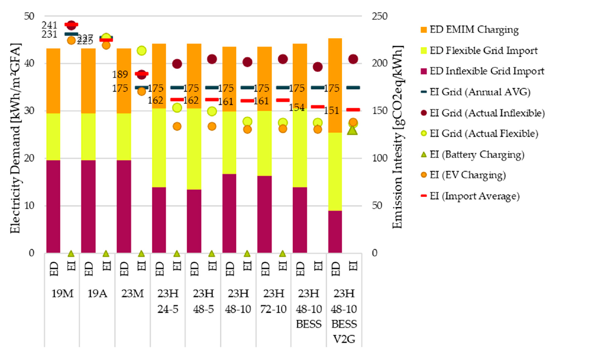

**When energy is used changes a district's impact.** The hourly annual simulation shows how buildings, hot water, batteries and EVs respond to PV surpluses and external enable signals. Annual indicators show the overall effect; hourly profiles explain it.

[Configure inputs](systems.qmd) · [Open hourly profiles](excel-dashboard.qmd) · [Compare variants](comparison.qmd)

## Setting up a comparison

::: {.excel-operation}
**Where in PEExcel?**

1. Save a reference variant with documented storage and flexibility settings.
2. On [🔋]{.excel-menu .darkred} **Flexibilität und Speicher**, initially change **one** measure: temperature band, battery capacity or C-rate. EV settings are on [🚗]{.excel-menu .orange} **Mobilität**.
3. Recalculate and save the measure variant. Keep weather, areas, PV and uses unchanged to isolate the measure.
4. Compare annual balances on [🔎 var]{.excel-menu .red} **Variantenvergleich**.
5. On [📈]{.excel-menu .red} **Dashboard**, compare the same winter and summer weeks: read demand, supply, temperatures and states of charge together.
:::

For multiple parameter levels, such as three storage sizes and two C-rates, calculate prepared variants by [batch](batch.qmd). This evaluates selected combinations; it does not automatically search for a global optimum.

## Research example: using hours with lower emissions

The **Quartier 4** case study investigates thermal flexibility with a heat pump and thermally activated building components, supplemented by a stationary battery and bidirectional EV use. Building demand, PV generation, uses and mobility demand remain unchanged. Emission factors, enable signals and storage options vary.

The monthly-assessed reference **23M** already uses thermal flexibility and a wind-peak signal. **23H 48-10** uses hourly emission factors and enables flexible use when the current factor is at least 10% below the mean of the next 48 hours. This foresight is a case-study assumption; practical control would need forecasts.

| Variant | Change in operational emissions balance relative to 23M | Change in electricity imports | Effective emissions intensity of imports |
|---|---:|---:|---:|
| 23M: monthly factors, thermal flexibility | Reference | Reference | 188.9 g CO₂e/kWh |
| 23H 48-10: hourly factors and GHG signal | −9.0% | +0.9% | 160.6 g CO₂e/kWh |
| Plus stationary battery | −10.4% | +2.3% | 154.2 g CO₂e/kWh |
| Plus stationary battery and bidirectional EV use | −10.0% | +5.1% | 151.3 g CO₂e/kWh |

Source: Schneider et al. (2025), section 3.3, table 9. The operational emissions balance includes the paper's B6–D2 life-cycle assessment; electricity imports are annual values. Relative changes are taken from the paper.

{.manual-figure}

**The result:** Lower emissions do not necessarily require lower electricity imports. Storage losses and additional charging can increase imports while shifting use to lower-emission hours improves assessed climate impact. Additional EV use does not achieve the lowest operational emissions balance here, even though import intensity falls further.

Assessment factors and control signals change together. Differences therefore cannot be attributed solely to storage. The paper sometimes calls the last variant V2G; here, the described supply to the building or district is termed bidirectional EV use.

## What to check in hourly profiles

- **Enablement and charging:** Does additional use actually occur during enabled hours?
- **Comfort:** Do room temperatures remain within the chosen band?
- **Storage use:** Does useful discharge follow charging, or do losses and high residual charge dominate?
- **Grid exchange:** Are imports and feed-in shifted in time? A better GHG balance does not prove a lower grid peak.
- **Annual effect:** How do self-consumption, imports, losses, full cycles and GHG balance change together?

The simulation resolves the year hourly. Subhourly peaks, grid voltages and transformer loading require finer or additional analysis.

::: {.declaration-note}
**Declaration:** This research example illustrates temporal assessment. Verification uses prescribed factors and assumptions; research variants do not replace them.
:::

[Publication: Declaration-Ready Climate-Neutral PEDs, section 3.3](https://doi.org/10.3390/designs9060123) · [Indicators and boundaries](results.qmd#kennzahlen) · [Mobility behaviour](mobility-analysis.qmd)
