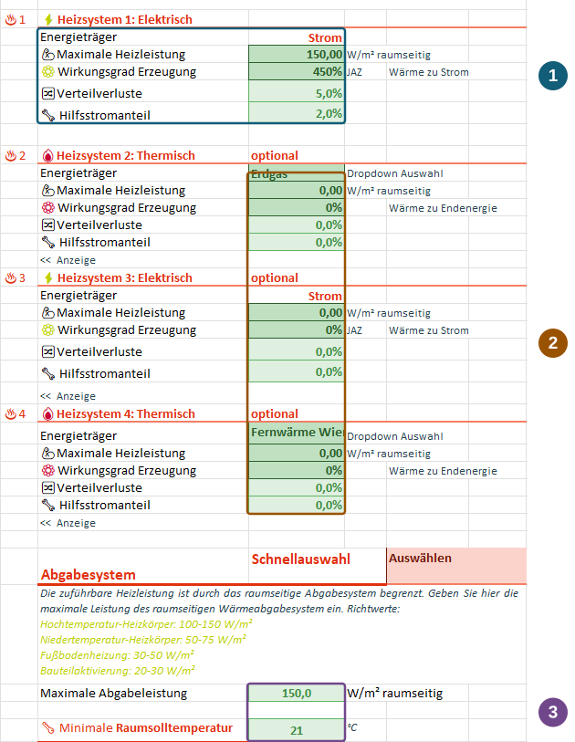
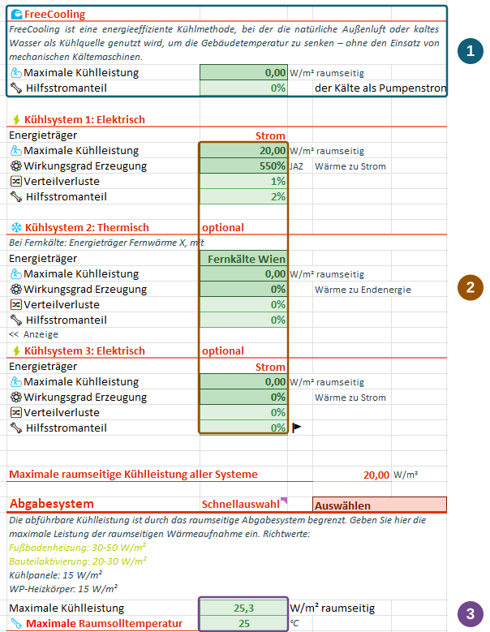
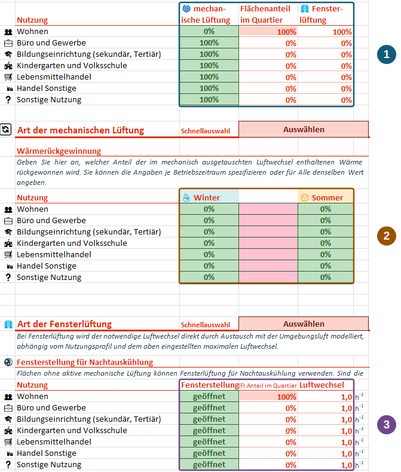

Use PEExcel to compare supply concepts at district scale: how do heat pumps, district heating, FreeCooling or heat recovery change heat and electricity balances? Inputs describe usable capacities, efficiencies and supply shares. They support concept assessment, rather than detailed design of individual systems or their controls.

::: {.excel-operation}
**Where in PEExcel?** Use [🔥H]{.excel-menu .darkred} **Heizung** (heating), [❄K]{.excel-menu .darkred} **Kühlung** (cooling), [💧WW]{.excel-menu .darkred} **Warmwasser** (hot water) and [💨L]{.excel-menu .darkred} **Lüftung** (ventilation). Start with a typical configuration through quick selection on the **klimaaktiv PEQ** ribbon or the relevant sheet, then adapt it.
:::

## Heating {#heizung}

Heating demand is met in a fixed order: **system 1 → 2 → 3 → 4**. Systems 1 and 3 are electric; systems 2 and 4 are thermal, with a selectable energy carrier. Each system contributes within its capacity limit, passing residual demand to the next. The room-side heat-emission system additionally limits total heat delivery.

These four positions primarily allow base and peak loads to be arranged appropriately. They do not represent an arbitrarily controlled multivalent plant with freely optimised dispatch.

### Example: district heating for base load, electricity for peaks

Set system 1 capacity to zero. Select district heating for system 2 and limit its capacity to the desired base load. System 3 represents direct electric peak heating with a heat-to-electricity generation efficiency of 1:1. Leave system 4 unused. District heating then meets demand up to its limit; electric heating supplies the remainder where its capacity and the emission system permit.

### Reading the input blocks

{#fig-heizung fig-alt="Heating sheet highlighting capacity, efficiency and losses, additional generators, maximum heat delivery and minimum room-temperature setpoint." width=700}

1. **Generation and energy input:** Enter maximum heating capacity and efficiency. For heat pumps, **Wirkungsgrad Erzeugung** represents the **seasonal performance factor**: 450% in the screenshot means 4.5 units of heat per unit of electricity. Distribution losses represent heat lost on the way to use. The auxiliary-electricity share of electric systems relates to their required electrical drive energy, not total heat demand.
2. **Additional generators:** Select carriers and capacity limits so the fixed order represents your concept. Unused systems have no available capacity. Check the reference quantity for auxiliary energy for each system; the statement about electric drive energy cannot be applied generally to thermal generators.
3. **Room-side limit:** The emission system and its maximum capacity limit usable heat delivery. The minimum room-temperature setpoint defines the heating temperature level. Also check the heating season.

Calculate and compare heat demand, energy carriers and electricity demand on the [results sheet](results.qmd) to see the effects of base-load and peak-load assumptions.



## Cooling {#kuehlung}

Actively cooled floor-area shares are assigned by use. The thermal model distinguishes actively cooled and non-actively cooled zones with no heat exchange between them. FreeCooling and subsequent cooling systems serve the **actively cooled areas**.

### What FreeCooling means here

FreeCooling represents additionally available cooling for which no chiller energy is assumed in the model. It may come from different sources and configurations, such as cool water. No detailed plant model is required: enter the available cooling potential as a maximum capacity.

**FreeCooling does not mean that no electricity is needed.** Use the auxiliary-electricity share to account for pumps, for example. This share relates to FreeCooling output. How much potential reaches the rooms is limited by cooling demand and room-side capacity; detailed source simulation and plant control are not represented.

{#fig-kuehlung fig-alt="Cooling sheet with highlighted FreeCooling inputs, system capacities and efficiencies, room-side capacity and maximum room-temperature setpoint." width=700}

1. **FreeCooling:** Set available capacity and its auxiliary-electricity share.
2. **Further cooling systems:** Select energy carriers, capacity and efficiency. For electric cooling, delivered cooling relates to electricity input. Enter distribution losses and auxiliary electricity separately.
3. **Room-side delivery:** Check the emission system, maximum room-side cooling capacity and maximum room-temperature setpoint. Define the months during which cooling is available.

::: {.callout-warning title="Caution"}
Window-based night cooling applies to **areas without active cooling**. The model cannot apply active cooling and additional window night cooling to the same floor-area share. A district can contain both in different areas.
:::

After calculation, evaluate the actively cooled zone's heat balance and cooling electricity. For example, compare variants with and without available FreeCooling potential.



## Domestic hot water {#warmwasser}

Two hot-water systems can be assigned through use-specific shares. For example, **a heat pump may supply apartments while instantaneous electric heaters supply offices**. Assign the corresponding shares to each use and check generator parameters.

Generation, distribution and storage are separate inputs. Hot-water heat demand describes the heat required; final-energy input also depends on efficiency and losses. Check energy carrier, generation efficiency, distribution and storage losses, and auxiliary electricity for both systems. Check storage size and temperature level as well. Configure flexible temperature increases separately under [storage and flexibility](systems.qmd#warmwasserspeicher).



## Ventilation {#lueftung}

For each use, define the floor-area shares ventilated mechanically and naturally through windows. These shares divide the use into areas. **50% mechanical and 50% window ventilation means two equally sized subareas**, not two complete air changes in the same area.

Both types implement the air-change rate and temporal profile specified in the use profile. To account for additional air exchange from inefficient ventilation or extra window opening, choose a corresponding air-change assumption. Dividing floor area alone does not increase air exchange.

{#fig-lueftung fig-alt="Ventilation sheet showing shares by use, winter and summer heat recovery, window positions and night-cooling air-change rates." width=720}

1. **Assign shares:** Check the mechanically ventilated share for each use and the remaining window-ventilated share. The district floor-area share indicates the weight of each use in the project.
2. **Set heat recovery:** The **winter and summer** values specify the recoverable share of heat in mechanically exchanged air. The tool interpolates sinusoidally between these seasonal values. They describe an annual pattern, not two independent systems. Identical values keep the share constant.
3. **Window night cooling:** Set window position and air-change rate for the intended areas. Natural-ventilation assignment must agree with the separation from actively cooled areas.

After calculation, check ventilation heat losses, heating and cooling demand, and ventilation electricity. Variant comparisons show how changes in heat recovery affect both the heat balance and supply-system demand.



The annotated screenshots show example configurations from a development version supplied by the project team. Their values are not general design recommendations. Click images to enlarge.[^hvac]

[^hvac]: Screenshots and technical explanations by the project team; [PEExcel training, slides 9, 11 and 15](../downloads/schulung.pdf#page=11) and manual pp. 49–60 (German).
