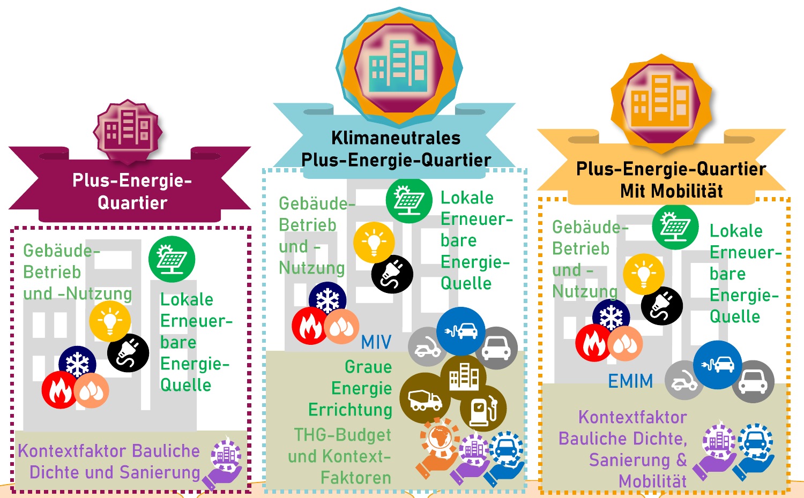

PEExcel · Positive energy districts
<h1>Simulate a year. Understand the alternatives.</h1>
Connect buildings, PV, storage and mobility across 8,760 hours. Assess energy flows, flexibility and climate impact together.

<a href="excel-overview.html">Start with Excel</a><a class="secondary" href="results.html">Understand results</a>

For **professional competence partners**, designers, consultants, researchers and students: PEExcel combines Excel with hourly simulation, traceable assessment methods and a Python interface. Developed by the [Climate-fit Buildings and Districts](https://www.technikum-wien.at/forschungsschwerpunkt-renewable-energy-systems/) research group at UAS Technikum Wien.

## What you can investigate

📊<h3>Compare variants</h3>
Assess individual measures and packages with consistent boundaries. <a href="comparison.html">Compare variants →</a>

🔋<h3>Use flexibility</h3>
Investigate building mass, hot water, batteries and EVs hour by hour. <a href="flexibility.html">Analyse flexibility →</a>

🚗<h3>Include mobility</h3>
Understand presence, charging and travel demand by use and season. <a href="mobility-analysis.html">Analyse mobility →</a>

## Connecting annual balances and hourly profiles

Annual balances show **how much** energy is needed and supplied. Hourly simulation shows **when** PV, demand and storage coincide. This lets you assess self-consumption, imports, storage losses and comfort together. Primary-energy and life-cycle GHG assessment complement physical flows.

[Results and indicators](results.qmd#kennzahlen) · [Hourly Excel dashboard](excel-dashboard.qmd) · [Model and inputs](model.qmd)

## Three levels of the positive-energy standard

1. **Positive energy district:** building operational energy and district-related supply.
2. **Positive energy district with mobility:** additionally, motorised private transport energy.
3. **Climate-neutral positive energy district:** additionally, life-cycle GHG emissions, especially embodied building emissions.

{.full-figure}

[Standard and background](research.qmd) · [What counts for a declaration?](declaration.qmd)

## Project comparison and time-resolved analysis

The [three refurbishment variants](examples.qmd) show heat, final-energy, primary-energy and GHG balances on a common data basis. **Aspern F7** adds [seasonal daily profiles and chronological hourly series](examples.qmd#aspern-f7).

The [schematic building section](envelope.qmd) distinguishes component assignment, thermal boundaries and qualitative heat flows.

[Methodology and research](research.qmd) · [Download Excel](download.qmd) · [Python interface](python.qmd) · [Python batch simulation (German)](../batch-python.html)

::: {.declaration-note}
**Declaration:** Custom assumptions can be modelled. A klimaaktiv declaration requires the **declaration values and assessment rules** of the relevant version. PV LCA can be modelled but is not included in the klimaaktiv assessment method.
:::
