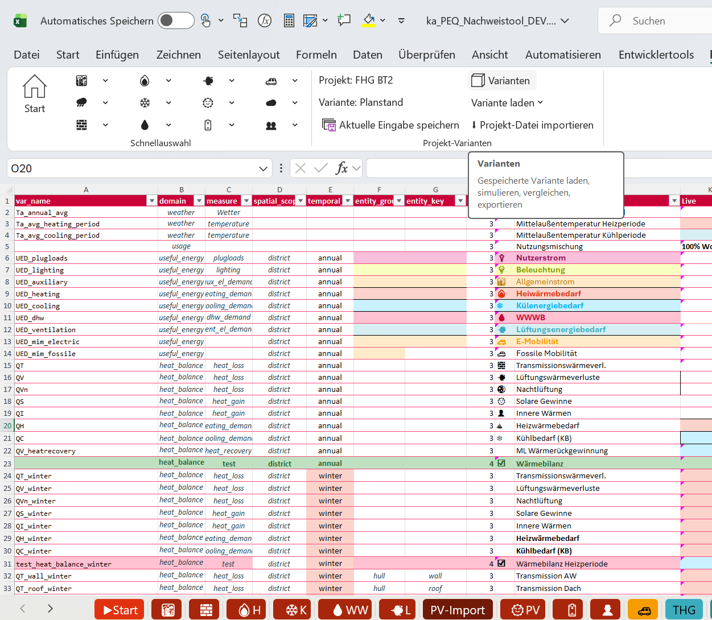
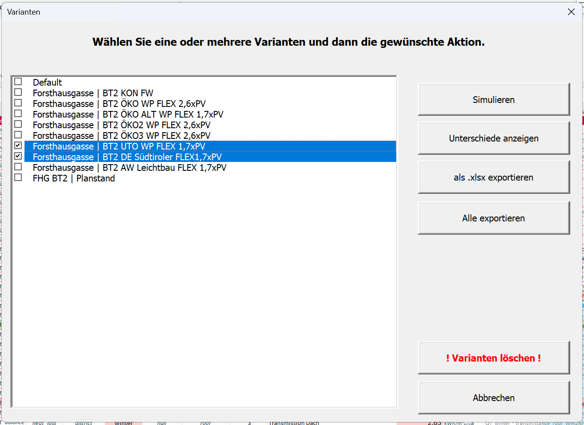
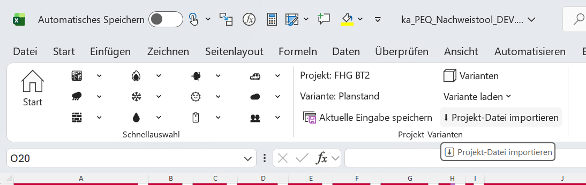
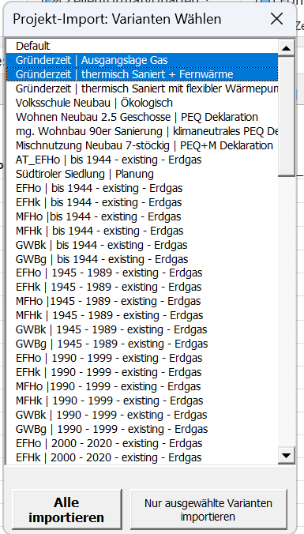
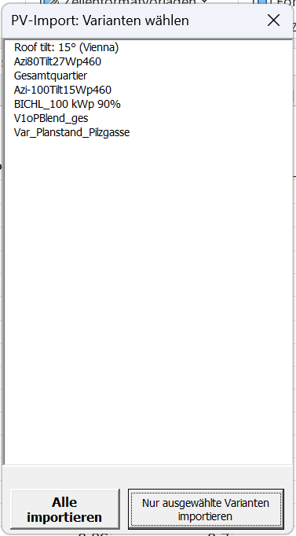
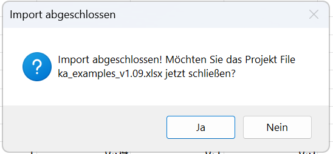
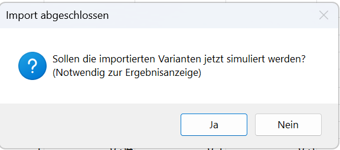

To continue an existing project in a newer PEExcel version, transfer saved variants through a **project export file**. This preserves your inputs while allowing you to benefit from improvements and fixes. Moving to the current released version is often useful before a new work phase. The [download page](download.qmd) lists versions and release notes.

This guide first exports variants from the old workbook, then imports them into the new version.[^migration] Keep the old workbook: it retains the previous editing and calculation state for comparison.

::: {.excel-operation}
**Where in PEExcel?** Use the **klimaaktiv PEQ** ribbon, **Projekt-Varianten** group: [Aktuelle Eingabe speichern]{.excel-action} (save current inputs), [Varianten]{.excel-action} (variants) and [Projekt-Datei importieren]{.excel-action} (import project file).
:::

## 1. Open variant management

Open the project in the old version. If you recently changed inputs, first save them as a variant using **Aktuelle Eingabe speichern**. Check project and variant names so you can identify the desired state later.

Click **Varianten** in **Projekt-Varianten** to choose which saved variants to transfer.

{#fig-migration-varianten fig-alt="Excel ribbon showing Variants and Save current inputs in the Project variants group."}

## 2. Export the required variants

Tick each variant to transfer in **Varianten**. Two are selected in the example. Click [als .xlsx exportieren]{.excel-action} (export as .xlsx) to export the selection. Use [Alle exportieren]{.excel-action} (export all) for all saved variants.

Save the export where you can find it easily. Include project name and date in the filename to identify its state.

{#fig-migration-export fig-alt="Variants dialog with two checked variants and Export as .xlsx and Export all buttons."}

## 3. Import the project into the new version

Download the desired released version from [downloads](download.qmd), save it as a separate working file and open it in Excel. Keep old and new workbooks separately.

In the new workbook, click **Projekt-Datei importieren** in **Projekt-Varianten**, select the saved `.xlsx` export and follow the import notices.

{#fig-migration-import fig-alt="Ribbon with Import project file highlighted."}

### Select project variants and PV profiles

In **Projekt-Import: Varianten Wählen**, select the variants to import and click [Nur ausgewählte Varianten importieren]{.excel-action} (import selected variants only). Use [Alle importieren]{.excel-action} (import all) for the full list.

If **PV-Import: Varianten wählen** appears, select the offered PV profiles your project needs, or import all offered profiles. Check their assignment to project variants afterwards.

::: {layout-ncol=2}
{#fig-migration-import-auswahl fig-alt="Project import dialog with two selected entries and buttons for all or selected variants."}

{#fig-migration-import-pv fig-alt="PV import dialog with profile list and buttons for all or selected entries."}
:::

### Complete the import

**Import abgeschlossen** confirms completion. The tool then asks whether to close the opened project export file. [Ja]{.excel-action} (yes) closes that source file; [Nein]{.excel-action} (no) leaves it open, for example for inspection. Continue working in the new tool workbook.

{#fig-migration-import-fertig fig-alt="Import complete message asking whether to close ka_examples_v1.09.xlsx, with Yes and No buttons." width=550}

### Simulate imported variants

The next question is **Sollen die importierten Varianten jetzt simuliert werden?** (Simulate imported variants now?). Choose **Ja** to calculate. Simulation is required to display results. **Nein** postpones calculation; run it later through variant management before evaluating results.

{#fig-migration-simulation fig-alt="Import complete dialog asking whether to simulate imported variants, with Yes and No buttons." width=580}

Screenshots show a supplied development version and example dialogs. Export and import views use different example projects. Labels and dialogs may differ by version. Click to enlarge.

## 4. Check the transferred project and recalculate

Load an imported variant and inspect inputs, especially new or changed parameters. If you use custom weather or PV profiles, check that they exist in the new tool and are assigned correctly. This ensures the next calculation uses the intended project state.

If you postponed simulation or corrected inputs, calculate now with the new version. Compare results with the previous state. Repeat for other variants you intend to use. Save the new workbook and record the version used.

## Why results may change

A new version may include fixes, different defaults or changes to calculation and methodology. Results may therefore change for the same transferred project. First verify identical inputs and profiles, then consult release notes.

Use newly calculated results for further work. Keep previous results in the old workbook for comparison. Do not copy calculation sheets between versions: the new workbook must use its own consistent formulas and data structures.

See [managing variants](variants.qmd) for organising project states and [quality assurance](declaration.qmd#qualitaetssicherung) for subsequent verification.

[^migration]: PEExcel training dated 14 October 2026, [slide 25: project export](../downloads/schulung.pdf#page=25). Screenshots supplied by the project team.
