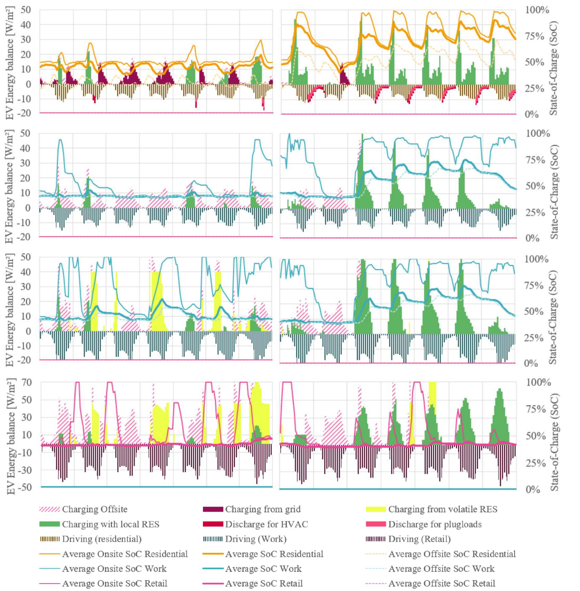

**Parking periods determine when EVs can absorb and supply energy.** PEExcel connects hourly presence and travel demand with PV, charging infrastructure and other district demand. Comparing uses and seasons shows where flexible charging is effective.

[Mobility model and inputs](mobility.qmd) · [Excel dashboard](excel-dashboard.qmd) · [Flexibility](flexibility.qmd)

## Comparing winter and summer

{.manual-figure}

The figure shows a winter week from 28 January to 3 February and a summer window in July. The left axis shows area-specific energy flows as mean hourly power; the right shows **SoC** in percent. Summer charts are on the **right**.

| Display | How to read it |
|---|---|
| Green | Charging from local renewable sources |
| Yellow-green | Charging from regional, intermittently available renewable surpluses |
| Dark purple | Other grid charging |
| Pink hatching | External charging outside the district |
| Narrow negative bars | Energy consumed for journeys |
| Red/pink discharge contributions | Vehicle supply to building services or user electricity |
| SoC lines | Average charge levels: on site, off site and across the vehicle group |

Driving energy and external charging explain the mobility balance but do not belong entirely to local electricity supply. Evaluate local charging energy separately from total attributed mobility demand.

## What the four uses show

**Housing:** Many vehicles are available in the evening and at night. In summer, PV-charged vehicles can later supply user electricity and systems, provided bidirectional use is enabled and minimum SoC is respected.

**Offices:** Daytime presence can coincide with PV generation. The effect depends on working days, parking periods and available charging power.

**School:** The model uses different simultaneity from offices and housing. Floor-area occupancy and statistically generated journeys must not be equated directly with a permanently present vehicle count.

**Supermarket:** Short stays and frequent turnover limit transferable energy per vehicle. Many different vehicles may generate charging demand although only a small share is present simultaneously.

See the [mobility model](mobility.qmd#anwesenheit) for the separate presence profiles and their data basis.

## Research example: bidirectional charging

In the paper's residential example, bidirectional charging down to an average minimum SoC of **60%** reduces annual grid demand for **heating and user electricity** from **29.3 to 21.3 kWh/m² net floor area**, about **28%**. Equivalent full cycles increase from **189 to 229**, about **20%**.

This illustrates a trade-off between avoided imports and increased battery use. It is neither a general saving in total mobility electricity demand nor a calculation of battery life. Values apply to the investigated configuration.

Source: Schneider and Baptista (2025), results, p. 5. Residential vehicles can supply the district in this model; discharge is not assumed for every use group.

## Evaluating your own mobility variant

::: {.excel-operation}
**Where in PEExcel?**

1. Save a reference with unchanged building, weather and PV.
2. On [🚗]{.excel-menu .orange} **Mobilität**, change one assumption, such as EV share, charging power or bidirectional use. Document minimum charge levels and vehicle capacities.
3. Calculate and save a separate variant.
4. On [📊 Erg]{.excel-menu .red} **Ergebnisse**, check local charging, external charging, mobility demand and EV full cycles.
5. On [📈]{.excel-menu .red} **Dashboard**, open the same winter and summer periods. Assess SoC and charging flows by use together.
6. On [🔎 var]{.excel-menu .red} **Variantenvergleich**, compare energy and GHG effects.
:::

A further comparison of mobility measures may change distance travelled. In that case, the causation-based mobility balance matters alongside charging flows.

## Scope and limitations

The model represents vehicle groups with average states of charge. It supports concept comparisons and investigations of the use mix. An adequate average SoC does not guarantee that every vehicle is sufficiently charged at departure. Individual charging schedules and short-term power peaks require more detailed data and models.

[Publication: Annual Hourly E-Mobility Modelling and Assessment](https://doi.org/10.1109/EEEIC/ICPSEurope64998.2025.11169136) · [Indicators](results.qmd#kennzahlen) · [Managing variants](variants.qmd)
