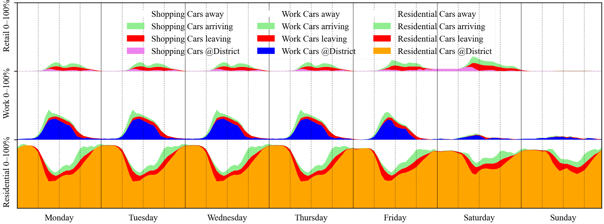



Distinguish physical charging flows from causation-based assessment. Both matter, but answer different questions.

## Which mobility is attributed?

The method considers responsibility for generated mobility. Destination traffic and an allocated national budget reference belong to this perspective. On-site charging energy is therefore not automatically identical to total attributed mobility energy.

{.manual-figure}

[{.full-figure}](../media/mobility.png)

Source: `docs/mobilität.png`; [training, slides 17–20](../downloads/schulung.pdf). The training cites *Österreich unterwegs 2014* as a data source. Assumptions and declaration values belonging to the tool version remain decisive.

## From inputs to hourly vehicle groups {#anwesenheit}

The model connects statistical floor-area occupancy and travel data with EV share, vehicle density and use-specific simultaneity. It creates vehicle groups for housing, work and shopping, tracking presence and average states of charge throughout the year.

| Input or data basis | Meaning in the model |
|---|---|
| Usable floor area and statistical occupancy | Expected number of mobile people by use |
| Mean distance travelled per person and location | Annual travel demand; mobility measures can change it |
| EV share and vehicle density | Electric share and number of assigned vehicles |
| Simultaneity factors | Relationship between statistical use and actual participants |
| Presence profiles | Hourly vehicle shares on site, off site, departing and arriving |
| Charging points, power and battery capacity | Technical limits on transferable energy |
| Minimum charge levels | Boundary between necessary charging and flexible headroom |

{.manual-figure}

**Hourly convention:** Departing vehicles remain present during the current hour and may charge before leaving. Arriving vehicles remain outside until the end of that hour. Profiles describe expected shares of a vehicle group, not individual schedules.

The data basis includes statistical mobility surveys, travel-distance literature and assumptions about EV shares and simultaneity. Charging/discharging responds to local PV and regional enable signals. The [hourly e-mobility research example](https://doi.org/10.1109/EEEIC/ICPSEurope64998.2025.11169136) explains the derivation.

## Where does charging actually happen?

For the energy system, what matters is when vehicles charge on site, their charging demand and interaction with PV, the grid and storage where applicable. This perspective considers the charging and traffic flows assumed in the model.

## Comparing with a clear question

Investigate mobility concepts while keeping the building model unchanged. Record location assumptions, travel distance, transport modes and charging concept. Evaluate mobility assessment and physical electricity balance separately.

::: {.callout-note collapse=true title="Research / Expert"}
Charging location alone does not determine causation-based allocation. Physical charging and assessment balances have different system boundaries. The tool's documented allocation is decisive.
:::

[Winter and summer mobility behaviour](mobility-analysis.qmd) · [Results and indicators](results.qmd#kennzahlen)

## Mobility in Excel {#excel-mobilitaet}

::: {.excel-operation}
**Where in PEExcel?** [🚗]{.excel-menu .orange} **Mobilität**.
:::

The training distinguishes **actual potential use** from **causation-based responsibility**. Storage and load-flow simulation considers EVs travelling in the district and their charging. The assessment allocates generated destination traffic, both electric and fossil.

::: {.excel-operation}
Select private motorised transport (MIV) modelling and calculation method. Check location, mobility measures, statistical MIV scaling, EV share and charging points. For actual charging, set capacities, efficiencies, internal/external minimum charge levels and, where applicable, bidirectional charging. After calculation, check mobility contributions on the [results sheet](results.qmd) and EV charge levels in the [dashboard](excel-dashboard.qmd).
:::

Location, parking spaces, alternative mobility services and charging infrastructure are different measures. Do not equate physical district charging with attributed mobility demand.

Source: [Training, slides 17–20](../downloads/schulung.pdf#page=19) (German).
