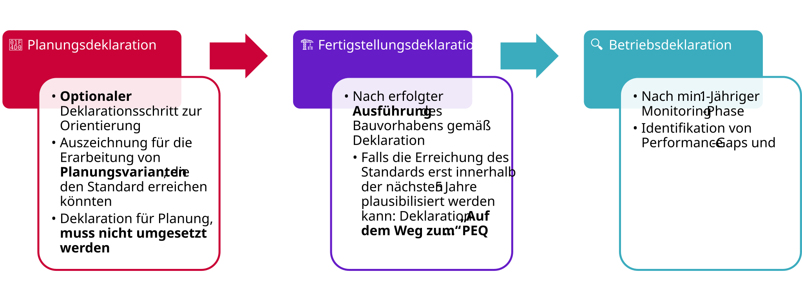
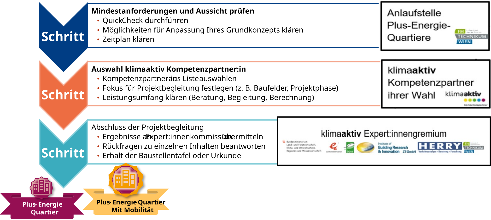
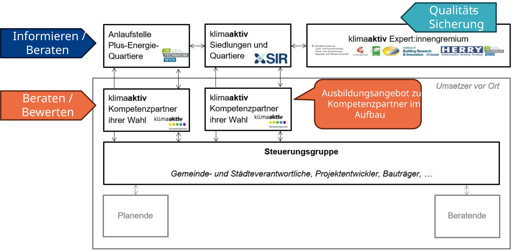

::: {.lead}
From the concept studied, through the implemented solution, to verified operation
:::

The klimaaktiv standard can be applied at different project stages. Distinguish two questions: **Which quality level is achieved in the calculation?** And **how robust is the underlying project status?** [The standard](research.qmd) describes quality levels; the declaration phase identifies the stage of verification.

## Three declaration phases

Verification can take place during design, after completion and using measured operational data. As the project progresses, the data basis and the declaration's significance change.

{#fig-deklarationsphasen width="100%"}

### 📐 Design declaration — demonstrating potential and variants

A **design declaration** recognises a well-founded investigation of a district concept. It shows **under which planning, technical and organisational conditions** a target quality level could be achieved. Especially early on, it supports what-if questions: How much PV area would be needed? Which heat supply or mobility measures would make the difference? How strongly do construction types affect the GHG balance?

The studied variant **does not have to be implemented exactly as assessed**. A design declaration is neither a commitment to build that variant nor proof of subsequent actual performance. What matters is a sufficiently detailed, traceable investigation and transparent identification of assumptions and dependencies.

### 🏗️ Completion declaration — checking implementation

The **completion declaration** assesses the **district actually built or refurbished**. Compare design measures with the as-built state: envelope, installed heat generation, available PV areas and capacities, storage, charging infrastructure and implemented mobility services.

Document deviations from earlier variants and reassess them where relevant to the balance. The basis is evidenced construction and the resulting calculated target achievement, not merely the original design result.

### 🔍 Operational or monitoring declaration — demonstrating performance in use

The **operational declaration** supplements model-based assessment with **measured operational data** from at least one year of monitoring. Compare energy imports, generation and feed-in, and further flows and operating conditions where measurable and relevant to the quality level, with assessment assumptions.

Sound interpretation considers weather, occupancy, changes in use and technical-system availability. Monitoring identifies differences between predicted and actual performance. It does not replace assessment of life-cycle or mobility emissions that cannot be measured directly.

| Phase | Assessment basis | What the declaration establishes |
|---|---|---|
| 📐 **Design** | District concept, technical assumptions and investigated variants | Conditions under which a quality level is achievable |
| 🏗️ **Completion** | Evidenced construction and updated calculation | Whether the implemented project meets requirements |
| 🔍 **Operation / monitoring** | Measurements and documented operating conditions | The extent to which predicted performance is confirmed in operation |

: Assessment basis and significance of declaration phases. {#tbl-deklarationsphasen}

::: {.callout-warning appearance="simple" icon=true title="Caution"}
**Quality level** describes the scope of energy and GHG requirements met. **Declaration phase** indicates whether assessment uses design assumptions, actual construction or measured operation. These are independent and must be reported together.
:::

## 🧭 “On the way” — reaching the target in stages

Not every district meets all requirements for its intended quality level **at the time of verification**. Particularly in existing districts or phased development, important measures may take effect later.

The declaration **“Auf dem Weg zum Plus-Energie-Quartier”** (“On the way to a positive energy district”) accounts for such pathways where later achievement within the intended period can be demonstrated plausibly. The concept provides a period of up to five years.

Distinguish a general intention from a **technically and temporally credible implementation pathway**. Suitable evidence may include:

- **Reserved PV areas:** secured roof or façade areas, including load capacity, shading, cable routes and future connection.
- **Prepared energy flexibility:** metering, control and communication infrastructure plus an implementable control concept.
- **Technical provisions:** conduits, space, routes or electrical connection reserves for expansion.
- **Traceable stages:** specific measures, responsibilities, prerequisites and implementation dates.

Such a pathway **does not prove a quality level has already been achieved**. Present the current state and intended complete achievement separately.

GHG assessment must also include emissions before later implementation and additional manufacturing emissions of the measures. A good future result does not undo emissions already incurred.

See [LCA](climate.qmd) for refurbishment and life-cycle assessment.

::: {.declaration-note}
**Declaration:** Binding conditions for “On the way”, particularly deadlines, evidence and quality-level assignment, follow the applicable declaration requirements.
:::

## Verification process

A network of the contact point, competence partners and expert panel supports the path to klimaaktiv recognition. For project owners, the process has three steps.

{#fig-weg-zum-peq width="100%"}

### Step 1 — check minimum requirements and prospects

First clarify the project's basic prerequisites and prospects of a successful declaration. A **PED Quick Check** can provide an initial assessment.

Discuss possible concept adjustments, outstanding requirements and a suitable timetable. The **Anlaufstelle Plus-Energie-Quartiere** contact point supports this initial orientation.

### Step 2 — select a competence partner

Project owners can select a **klimaaktiv competence partner** for detailed work.

Together, define project scope, boundaries, variants and the services required. These may include data collection, calculation, technical advice and preparation of declaration documents.

Competence partners support application of the standard and traceable preparation of evidence.

### Step 3 — submission and quality assurance

Once project support is complete, submit the required results and documents for professional review.

The **klimaaktiv expert panel** checks verification and may ask about assumptions, calculations or evidence. Successful review leads to the corresponding declaration or recognition.

Quality assurance supports technical plausibility, traceability and consistent application of the standard.

## Participants and responsibilities

Verification is embedded in the klimaaktiv settlements and districts programme. Participants have different, coordinated roles.

{#fig-programmteam width="100%"}

- **PED contact point:** initial information, advice on applicability and verification questions.
- **klimaaktiv settlements and districts:** programme coordination and support for quality-assurance and advisory structures.
- **klimaaktiv competence partners:** project advice, assessment and support preparing evidence.
- **klimaaktiv expert panel:** technical quality assurance and review of submitted results.
- **Project owners and technical designers:** project development, data provision, implementation and evidence documentation.

Cooperation should enable traceable assessment while keeping responsibilities for design, calculation and quality assurance distinct.

## Data quality and traceability

Verification combines architecture, building physics, building services, mobility planning and LCA. For influential inputs, identify **reference assumptions**, **project-specific calculations**, **confirmed as-built information** or **measurements**. Make dependencies on unsecured measures visible.

Keep district boundary, uses, area references and assessment version consistent in variant comparisons. If these change, identify their effects on demand, context factors and allocated budgets.
