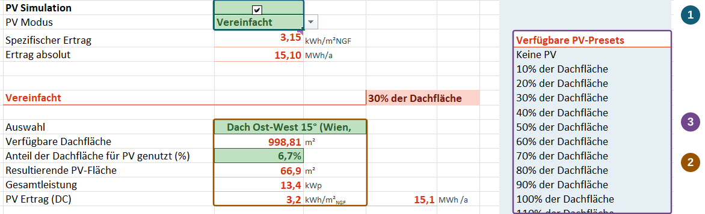
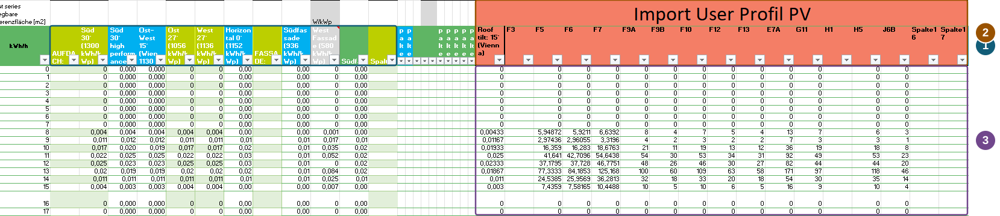



How much of your local PV generation can the district use itself? PEExcel connects hourly generation with electricity demand, storage charging and grid feed-in. Investigate how system size and timing affect supply. For an initial model, size PV using roof area. For a specific system design, use your own externally simulated generation profile.

::: {.excel-operation}
**Where in PEExcel?** Select and size the system on [🌞 PV]{.excel-menu .darkred} (**Photovoltaik**). Enter hourly profiles on **PV-Import**. Quick selection is also available on the **klimaaktiv PEQ** ribbon.
:::

## Simplified inputs: roof-area scaling {#dachflaechen-skalierung}

Set [PV Modus]{.excel-field} to **Vereinfacht** (simplified). Select a suitable generation profile, for example an east–west system. Available roof area and the proportion used for PV determine sizing. Check the resulting PV area, total capacity and yield.

{#fig-pv-skalierung fig-alt="PV sheet with highlighted simulation mode, profile selection with areas and capacity, and preset list."}

1. **Select the mode:** PV simulation and mode determine how generation is represented.
2. **Check sizing:** The profile describes generation timing. The roof-area share scales the system; the fields below show area, capacity and yield. Current inputs are decisive. After manual changes, a previously selected preset name may differ from the actual share, as the screenshot illustrates.
3. **Get started quickly:** Presets help compare roof-area shares. Start with a preset and adapt the inputs to your project.

Recalculate and check on the [results sheet](results.qmd#endenergiebilanz) how much PV electricity is used directly, stored or exported. Higher annual yield alone does not tell you whether additional generation coincides with demand.

## Detailed inputs: hourly generation profile {#profilimport}

If the system has been simulated specifically for the project, import its hourly profile. Document location, orientation, installed capacity and losses already included. **PV-Import** places standard profiles alongside **Import User Profil PV**.

{#fig-pv-profile fig-alt="Standard profiles on the left and the highlighted orange user-profile area with names and hourly values on the right."}

1. **Existing profiles:** The left-hand group contains profiles for different orientations and system types.
2. **Name your profiles:** Use the orange columns and assign unambiguous names.
3. **Enter hourly values:** Paste the annual series of 8,760 hours into the appropriate column. Only the first hours are shown. Check units and timing: mean hourly power in kW is numerically equal to energy in kWh over exactly one hour. Treat normalised and absolute profiles according to their reference capacity.

Select the profile on the PV sheet and check scaling and loss factors. Do not apply losses already included in the external simulation again. Weather and PV series must align in time; resolve missing hours or different calendars before importing.

Recalculate. Compare annual totals and typical daily profiles in the [Excel dashboard](excel-dashboard.qmd) with the external simulation to check magnitude and timing.

The screenshots come from a supplied development version and show example values. Click to enlarge.[^pv]

[Weather data](interfaces.qmd#wetter) · [Storage and flexibility](systems.qmd) · [PV LCA and assessment boundary](climate.qmd)

[^pv]: Screenshots and explanations by the project team; [PEExcel training, slides 9, 15 and 31](../downloads/schulung.pdf#page=31) (German).
