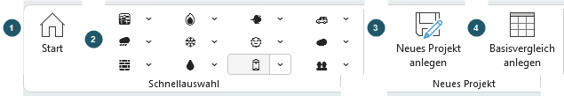
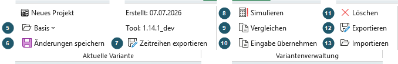
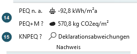
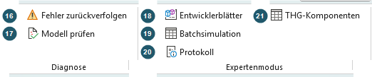
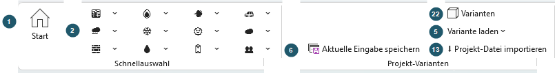

Das PEXL-Nachweistool ist nach Eingabegruppen, Berechnung und Auswertung gegliedert. Die wichtigsten Einstellungen werden über thematische Fachblätter vorgenommen; zusätzliche Blätter dienen der Speicherung von Varianten, der Simulation und der Ergebnisdarstellung.

{.manual-figure}

## Die wichtigsten Bereiche

Für die Anwendung lassen sich die Arbeitsblätter in drei Gruppen einteilen:

- **Eingaben:** Projekt, Gebäude, Energieversorgung, Mobilität und Ökobilanz.
- **Berechnung und Varianten:** gespeicherte Eingaben, Simulationen und Variantenverwaltung.
- **Auswertung und Nachweis:** Ergebnisblatt, Dashboard, Variantenvergleich, Deklarations- und Prüfblätter.

Die folgende Übersicht zeigt, wo die jeweiligen Einstellungen zu finden sind und welche Kapitel sie erläutern.

## Das Menüband im Überblick {#menueband}

Über das Menüband wählst du Voreinstellungen, speicherst Varianten und rufst Ergebnisse auf. Die Nummern verweisen auf die Funktionstabelle.

### Offizielle Version 1.13.3 {#ribbon-133}

Von links nach rechts findest du **Start und Schnellauswahl** (1–2), **Neues Projekt** (3–4), **Aktuelle Variante** (5–7), **Variantenverwaltung** (8–13) und **Nachweis** (14–15). In der Gruppe *Aktuelle Variante* siehst du auch den Projektnamen, das Erstellungsdatum und die Tool-Version.

Die Ausschnitte stammen aus 1.14.1_dev und zeigen die mit der offiziellen Version 1.13.3 gemeinsamen Bereiche.

{.manual-figure}

{.manual-figure}

{.manual-figure}

### Weitere Versionsansichten

::: {.callout-note collapse="true" #ribbon-dev}
## 1.14.1_dev – Diagnose und Expertenmodus

{.manual-figure}

Rechts neben **Nachweis** schließen in diesem Entwicklungsstand die Gruppen **Diagnose** (16–17) und **Expertenmodus** (18–21) an.
:::

::: {.callout-note collapse="true" #ribbon-127}
## 1.12.7 – Projekt-Varianten

{.manual-figure}

Auf **Start und Schnellauswahl** (1–2) folgt die Gruppe **Projekt-Varianten**. Hier findest du **Varianten** (22), **Variante laden** (5), **Aktuelle Eingabe speichern** (6) und **Projekt-Datei importieren** (13). Projekt- und Variantenname hängen von der geladenen Variante ab.
:::

### Funktionen im Menüband

| Nr. | Befehl oder Anzeige | Verwendung | Versionshinweis |
|---:|---|---|---|
| 1 | Start | Zum Startblatt wechseln. |  |
| 2 | Schnellauswahl | Ein Symbolmenü öffnen und eine [Voreinstellung](presets.qmd) für den jeweiligen Eingabebereich wählen. |  |
| 3 | Neues Projekt anlegen | Ein Projekt beginnen. |  |
| 4 | Basisvergleich anlegen | Einen Basisvergleich für das Projekt anlegen. |  |
| 5 | Variante auswählen | Über das Dropdown mit dem Variantennamen (im Bild „Basis“) eine gespeicherte Variante laden. | In [1.12.7](#ribbon-127) „Variante laden“. |
| 6 | Änderungen speichern | Die aktuellen Eingaben der Variante speichern. | In [1.12.7](#ribbon-127) „Aktuelle Eingabe speichern“. |
| 7 | Zeitreihen exportieren | Die Zeitreihen der aktuellen Variante ausgeben. |  |
| 8 | Simulieren | Die [Simulation](variants.qmd) starten. |  |
| 9 | Vergleichen | Die [Ergebnisse mehrerer Varianten](comparison.qmd) gegenüberstellen. |  |
| 10 | Eingabe übernehmen | Eingaben in die Variantenverwaltung übernehmen. |  |
| 11 | Löschen | Eine Variante aus dem Projekt entfernen. |  |
| 12 | Exportieren | Variantendaten für die Weitergabe exportieren. |  |
| 13 | Importieren | Variantendaten aus einer Projektdatei einlesen. | In [1.12.7](#ribbon-127) „Projekt-Datei importieren“. |
| 14 | Nachweis | Den angezeigten Status für PEQ, PEQ+M und KNPEQ zusammen mit den Kennwerten ablesen. |  |
| 15 | Deklarationsabweichungen | Abweichungen für die [Deklaration](declaration.qmd) einsehen. |  |
| 16 | Fehler zurückverfolgen | Die Ursache eines Modellfehlers nachverfolgen. | Nur in [1.14.1_dev](#ribbon-dev). |
| 17 | Modell prüfen | Die Modellprüfung starten. | Nur in [1.14.1_dev](#ribbon-dev). |
| 18 | Entwicklerblätter | Die Arbeitsblätter für die Modellentwicklung aufrufen. | Nur in [1.14.1_dev](#ribbon-dev). |
| 19 | Batchsimulation | Die [Simulation mehrerer Varianten](batch.qmd) aufrufen. | Nur in [1.14.1_dev](#ribbon-dev). |
| 20 | Protokoll | Das Protokoll einsehen. | Nur in [1.14.1_dev](#ribbon-dev). |
| 21 | THG-Komponenten | Die THG-Komponenten aufrufen. | Nur in [1.14.1_dev](#ribbon-dev). |
| 22 | Varianten | Die Variantenübersicht aufrufen. | Im Menüband von [1.12.7](#ribbon-127). |

## Blattnavigator

| Excel-Blatt | Beschreibung und Anleitung |
|---|---|
| Blatt [▶]{.excel-menu .darkred} ("Quick Start") | [Erste Schritte](excel-overview.qmd) und [Presets](presets.qmd) |
| Blatt [🏙]{.excel-menu .darkred} ("Quartier") | [Projekt, Flächen und Standort](model.qmd#quartier-eingeben) |
| Blatt [🌦]{.excel-menu .darkred} ("Wetter") | [Wetterdaten](interfaces.qmd#wetter) |
| Blatt [🧱]{.excel-menu .darkred} ("Bauphysik") | [Hülle und Speichermasse](envelope.qmd#excel-bauphysik) |
| Blatt [🔥H]{.excel-menu .darkred} ("Heizung") | [Heizung](hvac.qmd#heizung) |
| Blatt [❄K]{.excel-menu .darkred} ("Kühlung") | [Kühlung](hvac.qmd#kuehlung) |
| Blatt [💧WW]{.excel-menu .darkred} ("Warmwasser") | [Warmwasser](hvac.qmd#warmwasser) |
| Blatt [💨L]{.excel-menu .darkred} ("Lüftung") | [Lüftung](hvac.qmd#lueftung) |
| Blatt [🌞 PV]{.excel-menu .darkred} ("Photovoltaik") | [Photovoltaik](pv.qmd) |
| Blatt [PV-Import]{.excel-menu .darkred} ("PV-Import") | [Stundenprofil importieren](pv.qmd#profilimport) |
| Blatt [🔋]{.excel-menu .darkred} ("Flexibilität und Speicher") | [Speicher konfigurieren](systems.qmd) und [Flexibilität analysieren](flexibility.qmd) |
| Blatt [🚗]{.excel-menu .orange} ("Mobilität") | [Mobilität modellieren](mobility.qmd) und [Verhalten analysieren](mobility-analysis.qmd) |
| Blatt [☁ THG]{.excel-menu .teal} ("Graue Emissionen, Ökobilanz") | [Ökobilanz](climate.qmd) |
| Blatt [👤]{.excel-menu .darkred} ("Nutzungsparameter") | [Nutzerstrom und interne Gewinne](usage.qmd) |
| Blatt [📊 Erg]{.excel-menu .red} ("Ergebnisse") | [Ergebnisse und Kennzahlen](results.qmd) |
| Blatt [📈]{.excel-menu .red} ("Dashboard") | [Stündliche Diagramme](excel-dashboard.qmd) |
| Blatt [🔎 var]{.excel-menu .red} ("Variantenvergleich") | [Variantenvergleich](comparison.qmd) |
| Blatt [Scen]{.excel-menu .red} ("Batch-Simulation") | [Batch-Simulation](batch.qmd) |
| Blatt [PEQ]{.excel-menu .darkred} ("Plus-Energie-Quartier") | [Betriebsbilanz nachweisen](declaration.qmd#excel-nachweise) |
| Blatt [PEQ+M]{.excel-menu .orange} ("Plus-Energie-Quartier mit Mobilität") | [Mobilität einbeziehen](declaration.qmd#excel-nachweise) |
| Blatt [KN PEQ]{.excel-menu .teal} ("Klimaneutrales Plus-Energie-Quartier") | [Lebenszyklus bewerten](declaration.qmd#excel-nachweise) |
| Blatt [AUDIT]{.excel-menu .red} ("Qualitätssicherung") | [Qualitätssicherung](declaration.qmd#qualitaetssicherung) |

**IN**, **OUT** und **SIM2** bezeichnen interne Datenbereiche für Eingaben, Ergebnisse und stündliche Simulationen. Diese sind vom sichtbaren Ergebnisblatt **Erg** zu unterscheiden.

## So sind die Anleitungen aufgebaut

Die Website verwendet eine einheitliche Kennzeichnung von Excel-Orten, Eingabefeldern und Aktionen.

| Kennzeichnung | Bedeutung |
|---|---|
| Blatt [🔥H]{.excel-menu .darkred} ("Heizung") | Arbeitsblatt oder Menü im Excel-Tool |
| Feld [Maximale Heizleistung]{.excel-field} | Konkretes Eingabefeld |
| Befehl [Aktuelle Eingabe speichern]{.excel-action} | Auszuführende Aktion |
| Preset [„Fernwärme Wien“]{.excel-value} | Ausgewähltes Parameterpaket |
| Abschnitt [Heizsysteme]{.excel-section} | Thematischer Bereich eines Blatts |

Bedienanweisungen sind zusätzlich als **„Im Excel-Tool“** hervorgehoben.

Für die erste praktische Anwendung empfiehlt sich der [Schnellstart](excel-overview.qmd). Eine typische Konfiguration lässt sich anschließend mit [Presets](presets.qmd) aufbauen.

Quelle: [PEXL-Schulung, Folien 25, 28 und 30](downloads/schulung.pdf#page=25).
