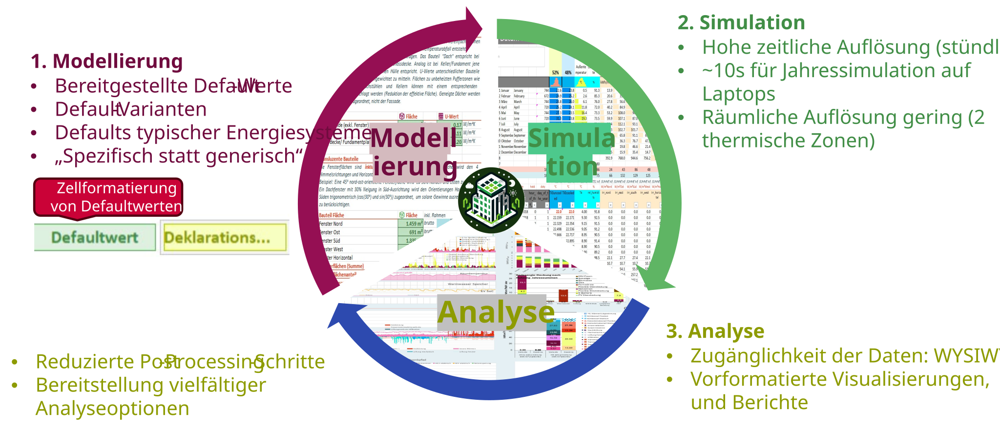

---
title: "Erste Schritte mit PEExcel"
---

PEExcel ist das Berechnungs- und Nachweiswerkzeug für den klimaaktiv Standard für Plus-Energie-Quartiere. Es verbindet Gebäudebetrieb, Energieversorgung, motorisierte Individualmobilität und Lebenszyklusemissionen in einem stündlichen Bewertungsmodell.

Mit dem Excel-Tool können Projektvarianten untersucht, berechnet und anhand ihrer Energie- und Treibhausgasbilanzen verglichen werden.

## Der Arbeitsablauf im Überblick 

Die Bearbeitung folgt einem wiederkehrenden Ablauf:

{.manual-figure}

Ausgehend von einer Projektbeschreibung werden Eingabeparameter und Maßnahmen festgelegt, die Berechnung durchgeführt und die Ergebnisse geprüft. Anschließend können Varianten angepasst und miteinander verglichen werden.

## In fünf Schritten zur ersten Auswertung

### 1. Excel-Tool herunterladen und öffnen

Lade das aktuelle [Excel-Tool](download.qmd) herunter, speichere sie lokal und öffne sie in Microsoft Excel. Für die erweiterten Bedien- und Variantenfunktionen müssen Makros zugelassen sein.

Bewahre für eigene Projekte eine unveränderte Ausgangsdatei auf.

### 2. Projekt und Ausgangsvariante festlegen

::: {.excel-operation}
**Excel-Ort:** Blatt Quick Start [▶]{.excel-menu .darkred}

Wähle die grundlegenden Projekt- und Geometrieparameter. Alternativ kannst du eine bereits [gespeicherte Variante laden](variants.qmd).
:::

Das Blatt **Quick Start** bietet einen schnellen Zugang zu den wichtigsten Modelleinstellungen.

{.manual-figure}

### 3. Konfiguration festlegen

Wähle geeignete [Presets](presets.qmd), beispielsweise für Gebäudehülle, Heizsystem oder Photovoltaik.

Presets übernehmen mehrere zusammengehörige Parameter. Die resultierenden Eingaben müssen anschließend auf ihre Eignung für das untersuchte Projekt geprüft werden.

Projektspezifische Änderungen erfolgen in den jeweiligen Fachblättern.

### 4. Berechnen und Ergebnisse prüfen

::: {.excel-operation}
**Im Excel-Tool:**

1. Berechnung mit <kbd>F9</kbd> auslösen.
2. Das [📊Erg]{.excel-menu .darkred} [Ergebnisblatt ](results.qmd) öffnen.
3. Primärenergie- und THG-Bilanz prüfen.
4. Bei Bedarf das [📈]{.excel-menu .darkred} [Excel-Dashboard](excel-dashboard.qmd) für weiterführende Auswertungen verwenden.
:::

Bei manuellem Berechnungsmodus sind die Ergebnisse erst nach einer erneuten Berechnung aktuell.

### 5. Variante speichern und vergleichen

Speichere den bearbeiteten Projektstand als eindeutig benannte [Variante](variants.qmd).

Anschließend kannst du einzelne Maßnahmen ändern, neu berechnen und die Ergebnisse im [Variantenvergleich](comparison.qmd) gegenüberstellen.

## Wie geht es weiter?

Für die weitere Bearbeitung bieten sich drei Zugänge an:

- [**Orientierung im Excel-Tool**](excel-navigation.qmd): Blätter, Farben und Eingabefelder verstehen.
- [**Modellieren**](model.qmd): Projektparameter und technische Systeme im Detail bearbeiten.
- [**Nachweisführung**](declaration.qmd): Anforderungen an Datenqualität, Deklarationswerte und Qualitätssicherung.

Für bestehende Projekte beschreibt [Migration](migration.qmd) die Übernahme von Eingaben zwischen Toolversionen.

Quelle: [PEExcel-Schulung, insbesondere Folien 3, 7–8 und 24–30](downloads/schulung.pdf#page=7).
