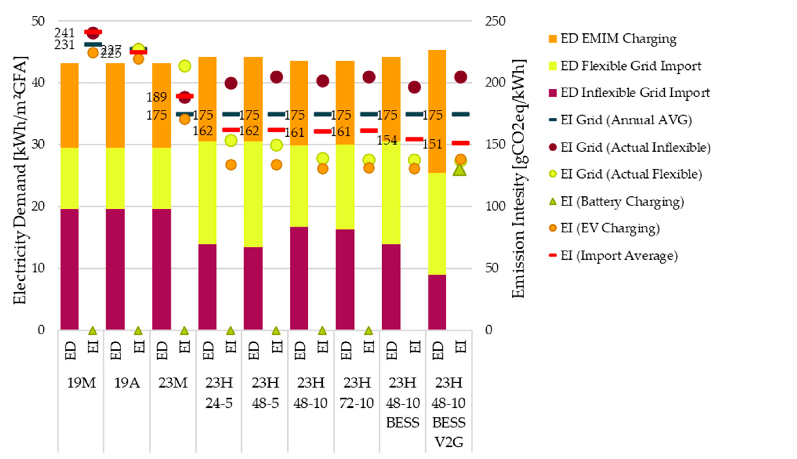

**Wann Energie genutzt wird, verändert die Wirkung eines Quartiers.** Die stündliche Jahressimulation zeigt, wie Gebäude, Warmwasser, Batterien und Elektrofahrzeuge auf PV-Überschüsse und externe Freigabesignale reagieren. Jahreskennzahlen machen die Gesamtwirkung sichtbar; Stundenverläufe erklären sie.

[Eingaben konfigurieren](systems.qmd) · [Stundenverläufe öffnen](excel-dashboard.qmd) · [Varianten vergleichen](comparison.qmd)

## Einen Vergleich aufbauen

::: {.excel-operation}
### Im Excel-Tool
1. Eine Referenzvariante mit dokumentierten Speicher- und Flexibilitätseinstellungen speichern.
2. Im Blatt [🔋]{.excel-menu .darkred} ("Flexibilität und Speicher") zunächst **eine** Maßnahme ändern: etwa das Temperaturband, die Batteriekapazität oder die C-Rate. EV-Einstellungen liegen im Blatt [🚗]{.excel-menu .orange} ("Mobilität").
3. Neu berechnen und die Maßnahmenvariante speichern. Wetter, Flächen, PV und Nutzungen für einen isolierten Maßnahmenvergleich gleich halten.
4. Im Blatt [🔎 var]{.excel-menu .red} ("Variantenvergleich") Jahresbilanzen gegenüberstellen.
5. Im Blatt [📈]{.excel-menu .red} ("Dashboard") dieselbe Winter- und Sommerwoche vergleichen: Strombedarf, Deckung, Temperaturen und Ladezustände gemeinsam lesen.
:::

Für mehrere Parameterstufen, etwa drei Speichergrößen bei zwei C-Raten, können die vorbereiteten Varianten per [Batch](batch.qmd) gerechnet werden. Ein solcher Variantenvergleich bewertet die gewählten Kombinationen; er ist keine automatische Suche nach einem globalen Optimum.

## Forschungsbeispiel: emissionsärmere Stunden nutzen

Die Fallstudie zu **Quartier 4** untersucht thermische Flexibilität mit Wärmepumpe und Bauteilaktivierung, ergänzt um eine stationäre Batterie und bidirektionale EV-Nutzung. Gebäudebedarf, PV-Erzeugung, Nutzungen und Mobilitätsbedarf bleiben als Grundlagen gleich. Verglichen werden unterschiedliche Emissionsfaktoren, Freigabesignale und Speicheroptionen.

Die monatlich bewertete Referenz **23M** nutzt bereits thermische Flexibilität und ein Windspitzensignal. **23H 48-10** verwendet stündliche Emissionsfaktoren und gibt flexible Nutzung frei, wenn der aktuelle Faktor mindestens 10 % unter dem Mittel der kommenden 48 Stunden liegt. Dieser Blick auf zukünftige Werte ist eine Annahme der Fallstudie; eine praktische Regelung benötigt dafür Prognosen.

| Variante | Änderung der betrieblichen Emissionsbilanz gegenüber 23M | Änderung des Stromimports | Effektive Emissionsintensität des Imports |
|---|---:|---:|---:|
| 23M: monatliche Faktoren, thermische Flexibilität | Referenz | Referenz | 188,9 g CO₂e/kWh |
| 23H 48-10: stündliche Faktoren und THG-Signal | −9,0 % | +0,9 % | 160,6 g CO₂e/kWh |
| Zusätzlich stationäre Batterie | −10,4 % | +2,3 % | 154,2 g CO₂e/kWh |
| Zusätzlich stationäre Batterie und bidirektionale EV-Nutzung | −10,0 % | +5,1 % | 151,3 g CO₂e/kWh |

Quelle: Schneider et al. (2025), Abschnitt 3.3, Tabelle 9. Die betriebliche Emissionsbilanz umfasst die dort ausgewiesene Lebenszyklusbewertung B6–D2; die Stromimporte sind Jahreswerte. Relative Änderungen sind aus dem Paper übernommen.

{.manual-figure}

**Das Ergebnis:** Weniger Emissionen erfordern nicht zwingend weniger Strombezug. Speicherverluste und zusätzliche Beladung können den Bezug erhöhen, während die Verschiebung in emissionsärmere Stunden die bewertete Klimawirkung verbessert. Die zusätzliche EV-Nutzung erzielt in diesem Beispiel nicht die niedrigste betriebliche Emissionsbilanz, obwohl die Importintensität weiter sinkt.

Bewertungsfaktoren und Steuersignale ändern sich gemeinsam. Die Unterschiede dürfen daher nicht allein als Speichereffekt interpretiert werden. Das Paper bezeichnet die letzte Variante teilweise als V2G; hier wird die beschriebene Versorgung des Gebäudes beziehungsweise Quartiers als bidirektionale EV-Nutzung eingeordnet.

## Was im Stundenverlauf zu prüfen ist

- **Freigabe und Beladung:** Fällt zusätzliche Nutzung tatsächlich in die freigegebenen Stunden?
- **Komfort:** Bleiben Raumtemperaturen innerhalb des eingestellten Bandes?
- **Speichernutzung:** Folgt auf Beladung eine nutzbare Entladung, oder dominieren Verluste und hohe Restladestände?
- **Netzaustausch:** Werden Bezug und Einspeisung zeitlich verändert? Eine günstigere THG-Bilanz beweist noch keine geringere Netzspitze.
- **Jahreswirkung:** Wie ändern sich Eigenverbrauch, Strombezug, Verluste, Vollzyklen und THG-Bilanz gemeinsam?

Die Simulation löst das Jahr in Stunden auf. Kurzzeitige Spitzen innerhalb einer Stunde, Netzspannungen und Trafobelastungen benötigen eine entsprechend feinere beziehungsweise ergänzende Untersuchung.

::: {.declaration-note}
**Für die Deklaration:** Das Forschungsbeispiel erläutert die Wirkung zeitlicher Bewertung. Für einen Nachweis gelten die vorgeschriebenen Faktoren und Annahmen; die untersuchten Forschungsvarianten ersetzen diese Vorgaben nicht.
:::

[Publikation: Declaration-Ready Climate-Neutral PEDs, Abschnitt 3.3](https://doi.org/10.3390/designs9060123) · [Kennzahlen und Bilanzgrenzen](results.qmd#kennzahlen) · [Mobilitätsverhalten](mobility-analysis.qmd)
