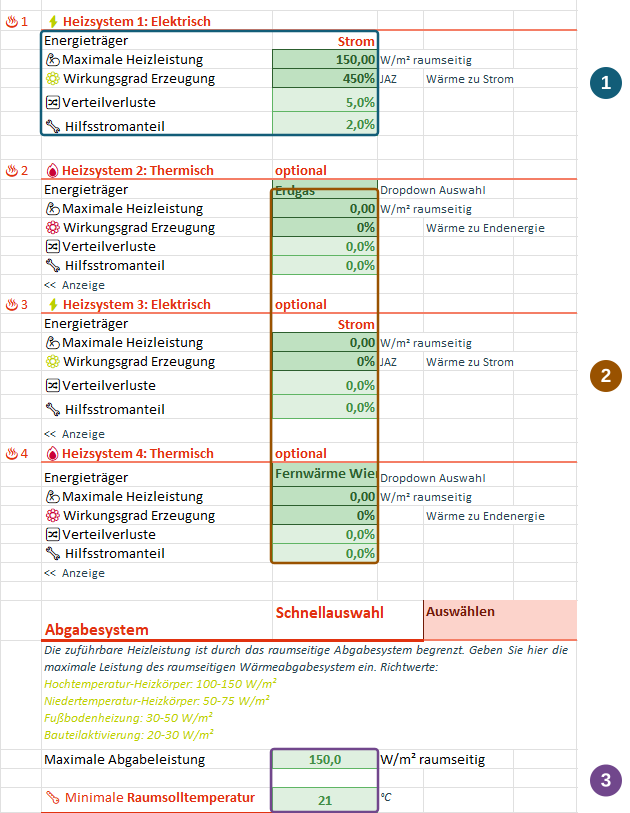
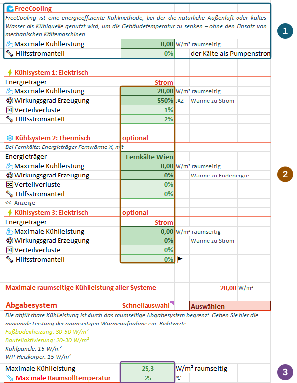
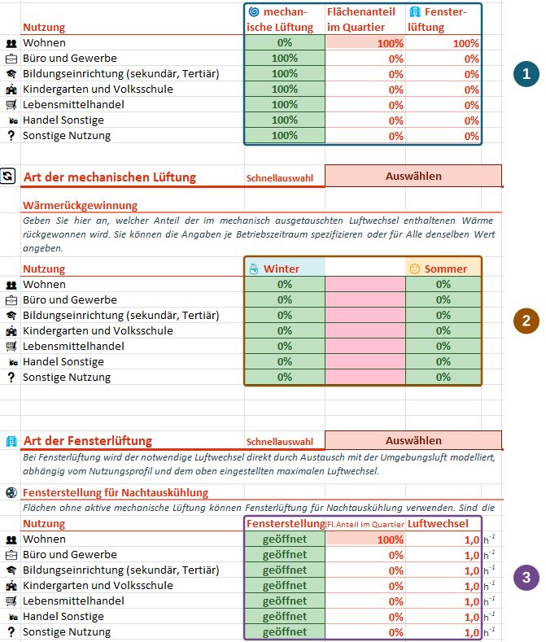

Mit PEExcel kannst du Versorgungskonzepte auf Quartiersebene vergleichen: Wie verändern Wärmepumpe, Fernwärme, FreeCooling oder Wärmerückgewinnung die Wärme- und Strombilanz? Die Eingaben beschreiben dafür nutzbare Leistungen, Effizienzen und Versorgungsanteile. Sie dienen der Konzeptbewertung; eine detaillierte Auslegung einzelner Anlagen oder ihrer Regelung ist damit nicht verbunden.

::: {.excel-operation}
**Wo findest du die Funktionen?** Verwende die Blätter [🔥H]{.excel-menu .darkred} **Heizung**, [❄K]{.excel-menu .darkred} **Kühlung**, [💧WW]{.excel-menu .darkred} **Warmwasser** und [💨L]{.excel-menu .darkred} **Lüftung**. Über die Schnellauswahl im Menüband **klimaaktiv PEQ** oder im jeweiligen Blatt kannst du mit einer typischen Konfiguration beginnen und sie anschließend anpassen.
:::

## Heizung {#heizung}

Die Deckung des Heizbedarfs folgt der festen Reihenfolge **System 1 → 2 → 3 → 4**. System 1 und 3 sind elektrisch, System 2 und 4 thermisch mit auswählbarem Energieträger. Jedes System trägt innerhalb seiner Leistungsgrenze zur Deckung bei; der verbleibende Bedarf wird an das nächste System weitergegeben. Zusätzlich begrenzt das raumseitige Abgabesystem die insgesamt mögliche Wärmeabgabe.

Die vier Positionen sind deshalb vor allem eine Möglichkeit, Grundlast und Spitzenlast passend anzuordnen. Sie bilden keine frei regelbare multivalente Anlage mit beliebiger Einsatzoptimierung ab.

### Beispiel: Fernwärme für die Grundlast, Strom für die Spitze

Für dieses Konzept setzt du die Leistung von System 1 auf null. In System 2 wählst du Fernwärme und begrenzt die Leistung auf die gewünschte Grundlast. System 3 bildet die direktelektrische Spitzenheizung ab; ihre Erzeugungseffizienz entspricht Wärme zu Strom von 1:1. System 4 bleibt ungenutzt. So deckt die Fernwärme zuerst den Bedarf bis zu ihrer Grenze; die elektrische Heizung übernimmt den verbleibenden Anteil, soweit ihre Leistung und das Abgabesystem dies zulassen.

### Die Eingabeblöcke lesen

{#fig-heizung fig-alt="Heizungsblatt mit markierten Leistungs-, Effizienz- und Verlustfeldern, weiteren Erzeugern sowie maximaler Abgabeleistung und minimaler Raumsolltemperatur." width=700}

1. **Erzeugung und Aufwand:** Trage maximale Heizleistung und Effizienz ein. Bei Wärmepumpen beschreibt der als „Wirkungsgrad Erzeugung“ bezeichnete Wert die **Jahresarbeitszahl**: 450 % im Screenshot entsprechen 4,5 Einheiten Wärme je Einheit Strom. Verteilverluste beschreiben den Wärmeverlust auf dem Weg zur Nutzung. Der Hilfsstromanteil elektrischer Systeme bezieht sich auf die benötigte elektrische Antriebsenergie, nicht auf den gesamten Wärmebedarf.
2. **Weitere Erzeuger:** Wähle Energieträger und Leistungsgrenzen so, dass die feste Reihenfolge dein Versorgungskonzept abbildet. Nicht verwendete Systeme erhalten keine verfügbare Leistung. Prüfe die Bezugsgröße der Hilfsenergie am jeweiligen System; die Aussage zur elektrischen Antriebsenergie ist nicht pauschal auf thermische Erzeuger übertragbar.
3. **Raumseitige Grenze:** Das Abgabesystem und seine maximale Leistung begrenzen die nutzbare Wärmeabgabe. Die minimale Raumsolltemperatur definiert das Temperaturniveau im Heizfall. Prüfe außerdem die eingestellte Heizperiode.

Berechne die Variante und vergleiche Wärmebedarf, eingesetzte Energieträger und Strombedarf im [Ergebnisblatt](results.qmd). So wird sichtbar, wie sich deine Grundlast- und Spitzenlastannahmen auswirken.



## Kühlung {#kuehlung}

Die aktiv gekühlten Flächenanteile werden je Nutzung zugeordnet. Das thermische Modell unterscheidet aktiv gekühlte und nicht aktiv gekühlte Bereiche ohne Wärmeaustausch zwischen diesen Modellzonen. FreeCooling und die nachfolgenden Kühlsysteme versorgen die **aktiv gekühlten Bereiche**.

### Was FreeCooling hier bedeutet

FreeCooling bildet zusätzlich verfügbare Kälte ab, für deren Bereitstellung im Modell keine Energie für eine Kältemaschine angesetzt wird. Sie kann aus unterschiedlichen Quellen und Anlagenkonfigurationen stammen, beispielsweise aus der Nutzung kühlen Wassers. Das Tool verlangt dafür kein detailliertes Anlagenmodell: Du gibst das verfügbare Kühlpotenzial als maximale Leistung an.

**FreeCooling bedeutet dabei nicht, dass überhaupt kein Strom gebraucht wird.** Über den Hilfsstromanteil berücksichtigst du beispielsweise Pumpen. Dieser Anteil bezieht sich auf die FreeCooling-Kälte. Wie viel des angesetzten Potenzials tatsächlich im Raum ankommt, wird durch den Kühlbedarf und die raumseitige Leistungsgrenze begrenzt; eine detaillierte Quellensimulation oder Anlagenregelung wird hier nicht nachgebildet.

{#fig-kuehlung fig-alt="Kühlungsblatt mit markierten FreeCooling-Eingaben, Leistungs- und Effizienzfeldern der Kühlsysteme und raumseitiger Kühlleistung sowie maximaler Raumsolltemperatur." width=700}

1. **FreeCooling:** Stelle verfügbare Leistung und den dazugehörigen Hilfsstromanteil ein.
2. **Weitere Kühlsysteme:** Wähle Energieträger, Leistung und Effizienz der nachfolgenden Systeme. Bei elektrischer Kälteerzeugung ist die abgegebene Kälte auf den eingesetzten Strom bezogen. Verteilverluste und Hilfsstrom werden getrennt eingegeben.
3. **Abgabe im Raum:** Prüfe das Abgabesystem, die maximale raumseitige Kühlleistung und die maximale Raumsolltemperatur. Zusätzlich legst du die Monate fest, in denen die Kühlung zur Verfügung steht.

::: {.callout-important title="Kühlung und Fenster-Nachtauskühlung getrennt zuordnen"}
Fenster-Nachtauskühlung wird für die **nicht aktiv gekühlten Bereiche** angesetzt. Für denselben Flächenanteil kannst du im Modell nicht gleichzeitig aktive Kühlung und zusätzliche Fenster-Nachtauskühlung ansetzen. Ein Quartier kann jedoch beide Arten in unterschiedlichen Bereichen enthalten.
:::

Nach der Berechnung wertest du die Wärmebilanz der aktiv gekühlten Zone und den Kühlstrom aus. Vergleiche dabei beispielsweise eine Variante mit und eine ohne verfügbares FreeCooling-Potenzial.



## Warmwasser {#warmwasser}

Zwei Warmwassersysteme können über nutzungsbezogene Anteile zugeordnet werden. Beispielsweise kann **eine Wärmepumpe die Wohnungen versorgen, während Durchlauferhitzer den Warmwasserbedarf der Büros decken**. Ordne dazu den Nutzungen die entsprechenden Systemanteile zu und prüfe die zugehörigen Erzeugerparameter.

Erzeugung, Verteilung und Speicherung sind getrennte Eingaben. Der Warmwasserwärmebedarf beschreibt die benötigte Wärme; der Endenergieeinsatz hängt zusätzlich von Effizienz und Verlusten ab. Kontrolliere deshalb Energieträger, Erzeugungseffizienz, Verteil- und Speicherverluste sowie Hilfsstrom für beide Systeme. Prüfe auch Speichergröße und Temperaturniveau. Die flexible Temperatursteigerung stellst du separat unter [Speicher und Flexibilität](systems.qmd#warmwasserspeicher) ein.



## Lüftung {#lueftung}

Je Nutzung legst du fest, welcher Flächenanteil mechanisch und welcher natürlich über Fenster belüftet wird. Die beiden Anteile teilen die Nutzung auf. **50 % mechanisch und 50 % Fensterlüftung bedeutet zwei entsprechend große Teilbereiche**, nicht zwei vollständige Luftwechsel im selben Bereich.

Beide Lüftungsarten setzen die im Nutzungsprofil hinterlegte Luftwechselrate mit ihrem zeitlichen Profil um. Wenn du zusätzlichen Luftwechsel durch ineffiziente Lüftung oder ergänzendes Fensteröffnen berücksichtigen möchtest, musst du eine dazu passende Luftwechselannahme wählen. Eine Aufteilung der Flächen allein erhöht den Luftwechsel nicht.

{#fig-lueftung fig-alt="Lüftungsblatt mit markierten Anteilen je Nutzung, getrennten Spalten für Wärmerückgewinnung im Winter und Sommer sowie Fensterstellungen und Luftwechsel für Nachtauskühlung." width=720}

1. **Anteile zuordnen:** Prüfe den mechanisch belüfteten Anteil je Nutzung und den verbleibenden Anteil der Fensterlüftung. Der Flächenanteil im Quartier zeigt, wie stark die jeweilige Nutzung im Projekt vertreten ist.
2. **Wärmerückgewinnung einstellen:** Die beiden Werte für **Winter und Sommer** geben an, welcher Anteil der in der mechanisch ausgetauschten Luft enthaltenen Wärme zurückgewonnen werden kann. Zwischen den saisonalen Werten interpoliert das Tool sinusförmig. Du beschreibst damit einen Jahresverlauf, nicht zwei unabhängige Anlagen. Bei identischen Winter- und Sommerwerten bleibt dieser Anteil konstant.
3. **Fenster-Nachtauskühlung:** Stelle Fensterstellung und Luftwechsel für die dafür vorgesehenen Bereiche ein. Die Zuordnung der natürlichen Lüftung und die Trennung von aktiv gekühlten Bereichen müssen dabei zusammenpassen.

Prüfe nach der Berechnung die Lüftungswärmeverluste, den Heiz- und Kühlbedarf sowie den elektrischen Lüftungsbedarf. Gerade beim Variantenvergleich wird sichtbar, dass eine andere Wärmerückgewinnung zugleich die Wärmebilanz und den Bedarf der Versorgungssysteme verändert.



Die markierten Bedienansichten zeigen vom Projektteam bereitgestellte Beispielkonfigurationen einer Entwicklungsfassung. Die Zahlen sind keine allgemeinen Auslegungsempfehlungen. Die Bilder lassen sich durch Anklicken vergrößern.[^hvac]

[^hvac]: Bedienansichten und fachliche Erläuterungen des Projektteams; ergänzend [PEExcel-Schulung, Folien 9, 11 und 15](downloads/schulung.pdf#page=11) und Handbuch S. 49–60.
