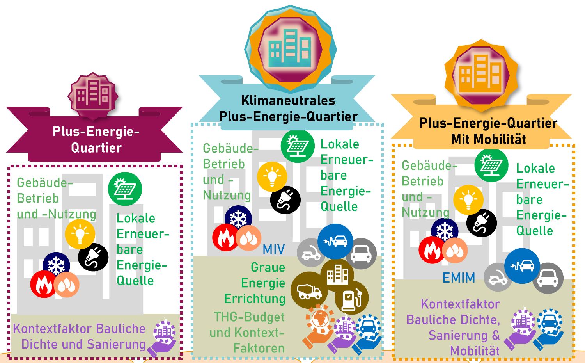

PEXL · Plus-Energie-Quartiere
<h1>Ein Jahr simulieren. Varianten verstehen.</h1>
Gebäude, PV, Speicher und Mobilität in 8.760 Stunden verknüpfen. Energieflüsse, Flexibilität und Klimawirkung gemeinsam bewerten.

<a href="excel-overview.html">Mit Excel starten</a><a class="secondary" href="results.html">Ergebnisse verstehen</a>

Für **professionelle Kompetenzpartner:innen**, Planende, Konsulent:innen, Forschende und Studierende: PEXL verbindet Excel mit stündlicher Simulation, nachvollziehbaren Bewertungsmethoden und einer Python-Schnittstelle. Entwickelt von der Forschungsgruppe [Climate-fit Buildings and Districts](https://www.technikum-wien.at/forschungsschwerpunkt-renewable-energy-systems/) an der FH Technikum Wien.

## Was du untersuchen kannst

📊<h3>Varianten vergleichen</h3>
Einzelmaßnahmen und Maßnahmenpakete mit denselben Bilanzgrenzen bewerten. <a href="comparison.html">Zum Variantenvergleich →</a>

🔋<h3>Flexibilität nutzen</h3>
Gebäudemasse, Warmwasser, Batterie und EVs im Stundenverlauf untersuchen. <a href="flexibility.html">Flexibilität analysieren →</a>

🚗<h3>Mobilität einbeziehen</h3>
Anwesenheit, Laden und Fahrbedarf nach Nutzung und Jahreszeit verstehen. <a href="mobility-analysis.html">Mobilitätsverhalten analysieren →</a>

## Jahresbilanz und Stundenverlauf verbinden

Die Jahresbilanz zeigt, **wie viel** Energie benötigt und bereitgestellt wird. Die stündliche Simulation zeigt, **wann** PV, Bedarf und Speicher zusammenpassen. So lassen sich Eigenverbrauch, Netzbezug, Speicherverluste und Komfort gemeinsam beurteilen. Die Primärenergie- und Lebenszyklus-THG-Bewertung ergänzt die physischen Flüsse.

[Ergebnisse und Kennzahlen](results.qmd#kennzahlen) · [Stündliches Excel-Dashboard](excel-dashboard.qmd) · [Modell und Eingaben](model.qmd)

## Drei Stufen des Plus-Energie-Standards

1. **Plus-Energie-Quartier:** Betriebsenergie der Gebäude und quartiersbezogene Versorgung.
2. **Plus-Energie-Quartier mit Mobilität:** zusätzlich Energiebedarf des motorisierten Individualverkehrs.
3. **Klimaneutrales Plus-Energie-Quartier:** zusätzlich Lebenszyklus-Treibhausgasemissionen, insbesondere graue Emissionen der Gebäude.

{.full-figure}

[Standard und Hintergrund](research.qmd) · [Was zählt für die Deklaration?](declaration.qmd)

## Anwendungsbeispiele

Die Beispiele zeigen, welche Fragen du mit PEXL untersuchen kannst: [Sanierungsvarianten vergleichen](examples.qmd), ihre Wärme-, Endenergie-, Primärenergie- und THG-Bilanzen gegenüberstellen und [PV-Nutzung sowie Netzbezug und Einspeisung im Stundenverlauf auswerten](examples.qmd#aspern-f7).

[Methodik und Forschung](research.qmd) · [Excel herunterladen](download.qmd)

::: {.declaration-note}
**Deklaration:** PEXL enthält hinterlegte Vorgabewerte für die Deklaration. Für Forschung und individuelle Untersuchungen lassen sich die Eingabeparameter projektspezifisch anpassen. Für eine klimaaktiv-Deklaration bleiben die **Deklarationswerte und Bewertungsregeln** der jeweiligen Version verbindlich; frei gewählte Annahmen sind gesondert zu prüfen. [Modellierung und Nachweis unterscheiden](declaration.qmd).
:::
