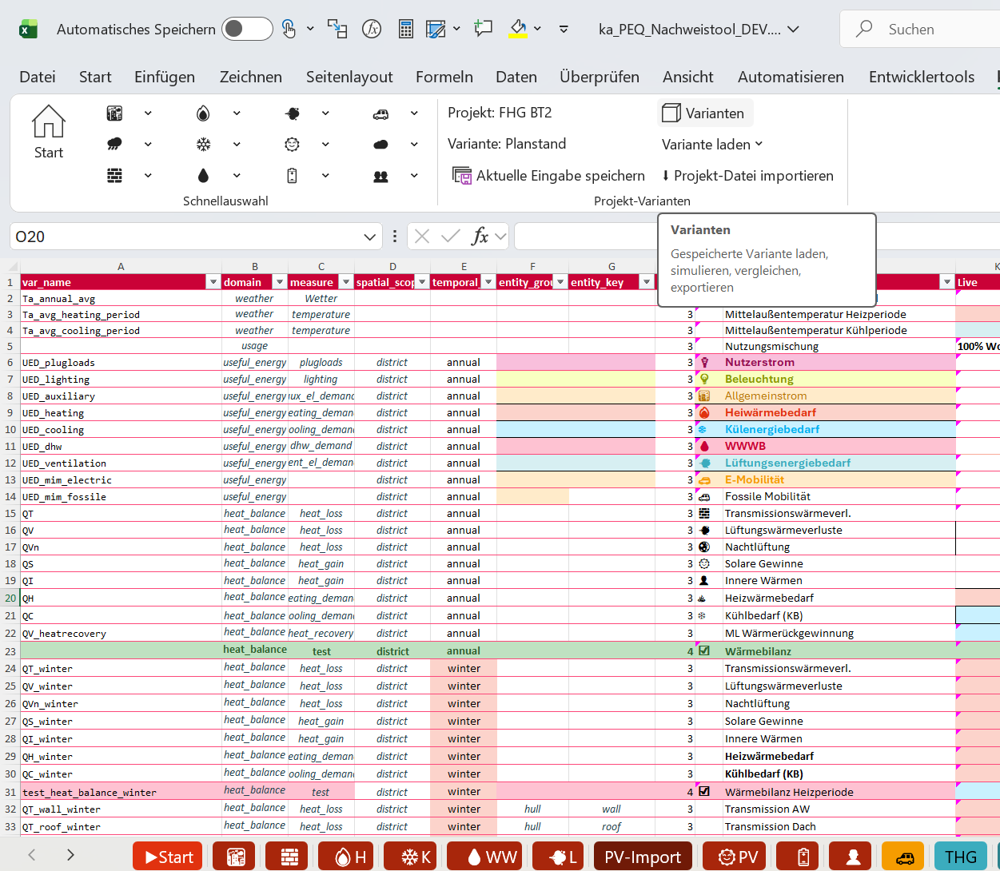
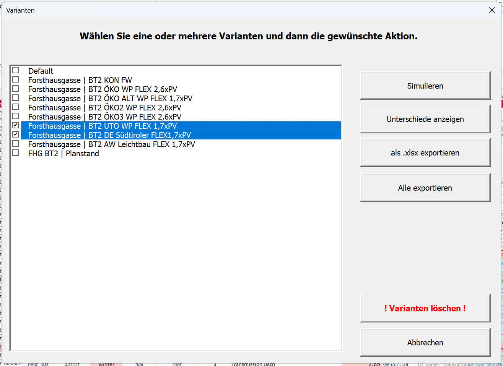
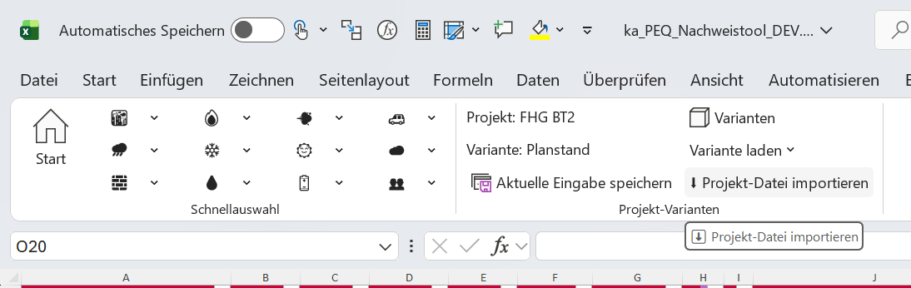
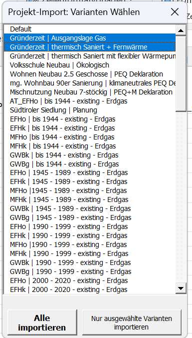
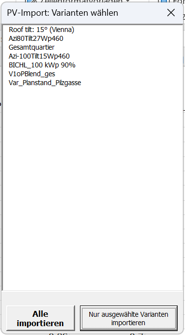
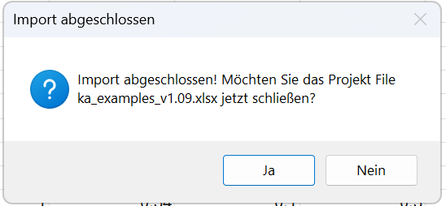
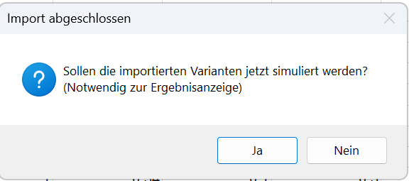

Wenn du ein bestehendes Projekt mit einer neueren PEExcel-Version weiterbearbeiten möchtest, überträgst du die gespeicherten Varianten über eine **Projekt-Exportdatei**. So kannst du deine bisherigen Eingaben weiterverwenden und von Verbesserungen und Fehlerkorrekturen der neuen Version profitieren. Ein Wechsel auf den aktuellen freigegebenen Stand ist deshalb oft sinnvoll, etwa bevor du eine neue Bearbeitungsphase beginnst. Auf der [Downloadseite](download.qmd) findest du die verfügbaren Versionen und ihre Versionshinweise.

In dieser Anleitung exportierst du zunächst deine Varianten aus der bisherigen Arbeitsmappe und importierst sie anschließend in die neue Toolversion.[^migration] Bewahre die bisherige Arbeitsmappe auf: Sie enthält den bisherigen Bearbeitungs- und Rechenstand und hilft dir später beim Vergleich.

::: {.excel-operation}
**Wo findest du die Funktionen?** Diese Anleitung führt dich durch den Export und Import im PEExcel-Menüband **klimaaktiv PEQ**, Gruppe **Projekt-Varianten**. Dort findest du [Aktuelle Eingabe speichern]{.excel-action}, [Varianten]{.excel-action} und [Projekt-Datei importieren]{.excel-action}. Die folgenden Schritte zeigen dir, wann du welchen Befehl verwendest.
:::

## 1. Die Variantenverwaltung öffnen

Öffne dein Projekt in der bisherigen Toolversion. Wenn du zuletzt Eingaben geändert hast, speichere sie zunächst mit [Aktuelle Eingabe speichern]{.excel-action} als Variante. Kontrolliere dabei den Projekt- und Variantennamen, damit du den gewünschten Stand anschließend wiedererkennst.

Klicke im Menüband in der Gruppe **Projekt-Varianten** auf [Varianten]{.excel-action}. In diesem Fenster wählst du aus, welche gespeicherten Varianten du mitnehmen möchtest.

{#fig-migration-varianten fig-alt="Excel-Menüband mit den Schaltflächen Varianten und Aktuelle Eingabe speichern in der Gruppe Projekt-Varianten."}

## 2. Die gewünschten Varianten exportieren

Setze im Fenster [Varianten]{.excel-action} ein Häkchen bei jeder Variante, die du übertragen möchtest. Im abgebildeten Beispiel sind zwei Varianten ausgewählt. Klicke anschließend auf [als .xlsx exportieren]{.excel-action}, um diese Auswahl zu exportieren. Wenn du sämtliche gespeicherten Varianten mitnehmen möchtest, steht dir stattdessen [Alle exportieren]{.excel-action} zur Verfügung.

Speichere die Exportdatei an einem Ort, an dem du sie für den nächsten Schritt leicht wiederfindest. Ein Dateiname mit Projektname und Datum hilft dir, den exportierten Stand später zuzuordnen.

{#fig-migration-export fig-alt="Dialog Varianten: Zwei Varianten sind angehakt. Rechts stehen die Schaltflächen als .xlsx exportieren und Alle exportieren."}

## 3. Die Projektdatei in die neue Version importieren

Lade die gewünschte freigegebene Toolversion von der [Downloadseite](download.qmd) herunter und speichere sie als eigene Arbeitsdatei. Öffne diese neue Datei in Excel. Deine bisherige Arbeitsmappe und die neue Arbeitsdatei bleiben damit getrennt erhalten.

Klicke in der neuen Arbeitsmappe in der Gruppe **Projekt-Varianten** auf [Projekt-Datei importieren]{.excel-action} und wähle die zuvor gespeicherte `.xlsx`-Exportdatei aus. Beachte die Hinweise, die das Tool während der Übernahme anzeigt.

{#fig-migration-import fig-alt="Excel-Menüband mit hervorgehobener Schaltfläche Projekt-Datei importieren in der Gruppe Projekt-Varianten."}

### Projektvarianten und PV-Profile auswählen

Im Dialog **Projekt-Import: Varianten Wählen** entscheidest du, welche Varianten aus der Exportdatei übernommen werden sollen. Markiere die gewünschten Einträge und klicke auf [Nur ausgewählte Varianten importieren]{.excel-action}. Möchtest du den gesamten Inhalt der Variantenliste übernehmen, wähle [Alle importieren]{.excel-action}.

Wenn der Dialog **PV-Import: Varianten wählen** erscheint, kannst du auch die angebotenen PV-Profile auswählen. Übernimm die Profile, die dein Projekt benötigt, oder verwende [Alle importieren]{.excel-action}, wenn du die gesamte angebotene Auswahl mitnehmen möchtest. Prüfe nach dem Import die Zuordnung der Profile zu deinen Projektvarianten.

::: {layout-ncol=2}
{#fig-migration-import-auswahl fig-alt="Dialog Projekt-Import mit einer Variantenliste, zwei markierten Einträgen und den Schaltflächen Alle importieren sowie Nur ausgewählte Varianten importieren."}

{#fig-migration-import-pv fig-alt="Dialog PV-Import mit einer Liste von PV-Profilen und den Schaltflächen Alle importieren sowie Nur ausgewählte Varianten importieren."}
:::

### Den Import abschließen

Die Meldung **Import abgeschlossen** bestätigt die Übernahme. Das Tool fragt anschließend, ob es die geöffnete Projekt-Exportdatei schließen soll. Mit [Ja]{.excel-action} schließt du diese Quelldatei; mit [Nein]{.excel-action} lässt du sie geöffnet, beispielsweise um noch etwas nachzusehen. Danach arbeitest du in der neuen Tool-Arbeitsmappe weiter.

{#fig-migration-import-fertig fig-alt="Meldung Import abgeschlossen mit der Frage, ob die Projektdatei ka_examples_v1.09.xlsx geschlossen werden soll, und den Schaltflächen Ja und Nein." width=550}

### Die importierten Varianten simulieren

Anschließend fragt das Tool: **Sollen die importierten Varianten jetzt simuliert werden?** Klicke auf [Ja]{.excel-action}, um die Berechnung zu starten. Die Simulation ist notwendig, damit die Ergebnisse angezeigt werden können. Mit [Nein]{.excel-action} verschiebst du die Berechnung auf später; führe sie dann über die Variantenverwaltung aus, bevor du die Ergebnisse auswertest.

{#fig-migration-simulation fig-alt="Dialog Import abgeschlossen: Sollen die importierten Varianten jetzt simuliert werden? Notwendig zur Ergebnisanzeige. Schaltflächen Ja und Nein." width=580}

Die Abbildungen zeigen die vom Projektteam bereitgestellte Entwicklungsfassung und Beispieldialoge. Die Export- und Importansichten verwenden unterschiedliche Beispielprojekte. Je nach verwendeter Toolversion können Beschriftungen und Dialoge abweichen. Zum Vergrößern kannst du auf die Bilder klicken.

## 4. Das übertragene Projekt prüfen und neu berechnen

Lade nach dem Import eine übertragene Variante und kontrolliere ihre Eingaben. Achte besonders auf neue oder geänderte Parameter. Wenn du eigene Wetter- oder PV-Profile verwendest, prüfe auch, ob diese im neuen Tool verfügbar und richtig zugeordnet sind. So stellst du sicher, dass die nächste Berechnung auf dem beabsichtigten Projektstand aufbaut.

Wenn du die Simulation im Abschlussdialog noch nicht gestartet hast oder Eingaben korrigiert hast, berechne die Variante jetzt mit der neuen Toolversion. Vergleiche die Ergebnisse anschließend mit deinem bisherigen Stand. Wiederhole diese Prüfung für die weiteren Varianten, die du weiterbearbeiten möchtest. Speichere die neue Arbeitsmappe und halte fest, mit welcher Toolversion du gerechnet hast.

## Warum sich Ergebnisse nach dem Wechsel ändern können

Eine neue Toolversion kann Fehlerkorrekturen, andere Vorgabewerte oder Änderungen an der Berechnung und Methodik enthalten. Deshalb können sich Ergebnisse auch dann ändern, wenn du dasselbe Projekt überträgst. Prüfe bei einer Abweichung zuerst, ob dieselben Eingaben und Profile verwendet werden, und ziehe anschließend die Versionshinweise heran.

Für die weitere Bearbeitung verwendest du die Ergebnisse, die du mit der neuen Version berechnet hast. Die bisherigen Ergebnisse bleiben in der alten Arbeitsmappe als Vergleich erhalten. Kopiere keine Berechnungsblätter zwischen den Versionen: Die neue Arbeitsmappe soll mit ihren zusammengehörigen Formeln und Datenstrukturen rechnen.

Wie du mehrere Projektstände organisierst, erfährst du unter [Varianten verwalten](variants.qmd). Für die anschließende Nachweisführung hilft dir die [Qualitätssicherung für den Nachweis](declaration.qmd#qualitaetssicherung).

[^migration]: PEExcel-Schulung vom 14.10.2026, [Folie 25: Projekt-Export](downloads/schulung.pdf#page=25). Die Bedienansichten wurden vom Projektteam für diese Anleitung bereitgestellt.
