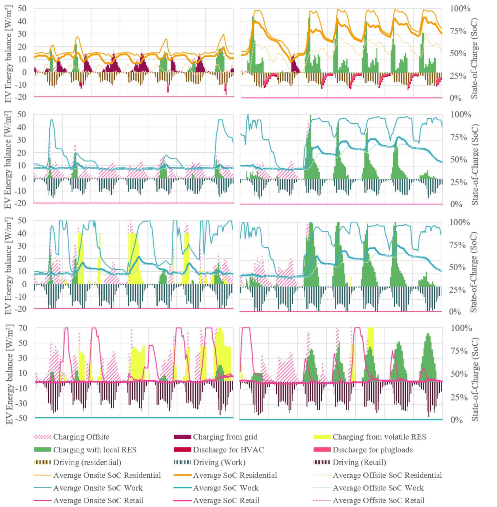

**Standzeiten bestimmen, wann Elektrofahrzeuge Energie aufnehmen und abgeben können.** PEExcel verknüpft stündliche Anwesenheit und Fahrbedarf mit PV, Ladeinfrastruktur und dem übrigen Quartiersbedarf. Der Vergleich von Nutzungen und Jahreszeiten zeigt, wo flexible Ladung wirksam wird.

[Mobilitätsmodell und Eingaben](mobility.qmd) · [Excel-Dashboard](excel-dashboard.qmd) · [Flexibilität](flexibility.qmd)

## Winter und Sommer vergleichen

{.manual-figure}

Die Forschungsabbildung zeigt eine Winterwoche vom 28. Jänner bis 3. Februar und ein Sommerfenster im Juli. Die linke Achse zeigt flächenbezogene Energieflüsse als mittlere Stundenleistung, die rechte den Ladezustand **SoC** in Prozent. Die Sommerdiagramme stehen **rechts**.

| Darstellung | So lässt sich das Diagramm lesen |
|---|---|
| Grün | Ladung aus lokalen erneuerbaren Quellen |
| Gelbgrün | Ladung aus regionalen, zeitweise verfügbaren erneuerbaren Überschüssen |
| Dunkelviolett | Weitere Ladung aus dem Netz |
| Rosa schraffiert | Externe Ladung außerhalb des Quartiers |
| Schmale negative Balken | Energieverbrauch für Fahrten |
| Rote beziehungsweise pinke Entladebeiträge | Versorgung von HKLS beziehungsweise Nutzerstrom durch Fahrzeuge |
| SoC-Linien | Durchschnittliche Ladestände: vor Ort, außerhalb und über die jeweilige Fahrzeuggruppe |

Die Fahrenergie und externe Ladung erklären die Mobilitätsbilanz, gehören aber nicht vollständig zur lokalen Stromversorgung. Deshalb lokale Ladeenergie und gesamten zugerechneten Mobilitätsbedarf getrennt auswerten.

## Was die vier Nutzungen zeigen

**Wohnen:** Viele Fahrzeuge sind abends und nachts verfügbar. Im Sommer können PV-beladene Fahrzeuge später Nutzerstrom und Anlagen versorgen, sofern bidirektionale Nutzung freigegeben ist und der Mindestladestand eingehalten wird.

**Büro:** Anwesenheit tagsüber bietet Überschneidungen mit PV-Erzeugung. Der Effekt hängt von Arbeitstagen, Standzeiten und der verfügbaren Ladeleistung ab.

**Schule:** Das Modell berücksichtigt eine andere Gleichzeitigkeit als bei Büro und Wohnen. Flächenbelegung und statistisch verursachte Fahrten dürfen nicht unmittelbar mit einer dauerhaft anwesenden Fahrzeugzahl gleichgesetzt werden.

**Supermarkt:** Kurze Aufenthalte und häufiger Fahrzeugwechsel begrenzen die je Fahrzeug übertragbare Energie. Viele verschiedene Fahrzeuge können Ladebedarf erzeugen, obwohl nur ein kleiner Anteil gleichzeitig anwesend ist.

Die getrennten Anwesenheitsprofile und ihre Datengrundlagen erläutert das [Mobilitätsmodell](mobility.qmd#anwesenheit).

## Forschungsbeispiel: bidirektionales Laden

Im Wohnbeispiel des Papers reduziert bidirektionales Laden bis zu einem mittleren Mindest-SoC von **60 %** den jährlichen Netzbedarf für **Heizung und Nutzerstrom** von **29,3 auf 21,3 kWh/m² NGF**, also um rund **28 %**. Gleichzeitig steigen die äquivalenten Vollzyklen von **189 auf 229**, rund **20 %**.

Das Beispiel zeigt einen Zielkonflikt zwischen vermiedenem Netzbezug und zusätzlicher Batterienutzung. Es beschreibt weder eine pauschale Einsparung des gesamten Mobilitätsstrombedarfs noch eine berechnete Batterielebensdauer. Die Werte gelten für die untersuchte Konfiguration.

Quelle: Schneider und Baptista (2025), Ergebnisteil, S. 5. Die Wohnfahrzeuge können im untersuchten Modell das Quartier versorgen; die Rückspeisung wird nicht pauschal auf alle Nutzungsgruppen übertragen.

## Eine eigene Mobilitätsvariante auswerten

::: {.excel-operation}
### Im Excel-Tool
1. Die Referenz mit unverändertem Gebäude, Wetter und PV speichern.
2. Im Blatt [🚗]{.excel-menu .orange} ("Mobilität") eine Annahme ändern, etwa EV-Anteil, Ladeleistung oder bidirektionale Nutzung. Mindestladestände und Fahrzeugkapazitäten dokumentieren.
3. Berechnen und als eigene Variante speichern.
4. Im Blatt [📊 Erg]{.excel-menu .red} ("Ergebnisse") lokale Ladung, externe Ladung, Mobilitätsbedarf und EV-Vollzyklen prüfen.
5. Im Blatt [📈]{.excel-menu .red} ("Dashboard") dieselben Winter- und Sommerzeiträume öffnen. SoC und Ladeflüsse nach Nutzung gemeinsam beurteilen.
6. Im Blatt [🔎 var]{.excel-menu .red} ("Variantenvergleich") Energie- und THG-Wirkung gegenüberstellen.
:::

Ein zusätzlicher Vergleich von Mobilitätsmaßnahmen kann die Fahrleistung verändern. Dann ist neben den Ladeflüssen auch die verursacherbezogene Mobilitätsbilanz relevant.

## Aussagekraft und Grenzen

Das Modell bildet Fahrzeuggruppen mit durchschnittlichen Ladezuständen ab. Es eignet sich für Konzeptvergleiche und die Untersuchung des Nutzungsmixes. Ein durchschnittlich ausreichender SoC garantiert nicht, dass jedes einzelne Fahrzeug zu seiner Abfahrt ausreichend geladen ist. Individuelle Ladeplanung und kurzzeitige Leistungsspitzen benötigen detailliertere Daten und Modelle.

[Publikation: Annual Hourly E-Mobility Modelling and Assessment](https://doi.org/10.1109/EEEIC/ICPSEurope64998.2025.11169136) · [Kennzahlen](results.qmd#kennzahlen) · [Varianten verwalten](variants.qmd)
