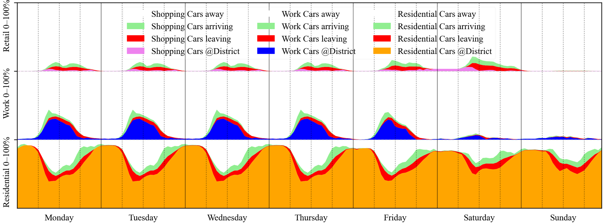

Physische Ladeflüsse von der verursacherbezogenen Bewertung unterscheiden. Beide sind relevant, beantworten aber verschiedene Fragen.

## Welche Mobilität wird zugerechnet?

Die Bewertungsmethode betrachtet die Verantwortung für verursachte Mobilität. Zielverkehr und ein zugeteilter nationaler Budgetbezug gehören zu dieser Perspektive. Ladeenergie am Standort ist deshalb nicht automatisch mit der gesamten zugerechneten Mobilitätsenergie identisch.

{.manual-figure}

[{.full-figure}](media/mobility.png)

Quelle: `docs/mobilität.png`; [Schulung, Folien 17–20](downloads/schulung.pdf). Die Schulung verweist auf *Österreich unterwegs 2014* als Datengrundlage. Maßgeblich bleiben die zum Toolstand gehörenden Annahmen und Deklarationswerte.

## Von Eingaben zu stündlichen Fahrzeuggruppen {#anwesenheit}

Das Mobilitätsmodell verbindet statistische Daten zu Flächenbelegung und Fahrleistung mit dem EV-Anteil, der Fahrzeugdichte und nutzungsspezifischen Gleichzeitigkeiten. Daraus entstehen Fahrzeuggruppen für Wohnen, Arbeit und Einkauf. Die Simulation verfolgt ihre Anwesenheit und mittleren Ladezustände über das Jahr.

| Eingabe oder Datengrundlage | Bedeutung im Modell |
|---|---|
| Nutzfläche und statistische Flächenbelegung | Erwartete Zahl mobiler Personen nach Nutzung |
| Mittlere Fahrleistung pro Person und Standort | Jährlicher Fahrbedarf; Mobilitätsmaßnahmen können ihn verändern |
| EV-Anteil und Fahrzeugdichte | Elektrischer Anteil und Zahl der zugeordneten Fahrzeuge |
| Gleichzeitigkeitsfaktoren | Verhältnis zwischen statistischer Nutzung und tatsächlich beteiligten Personen |
| Anwesenheitsprofile | Stündlicher Anteil der Fahrzeuge vor Ort, außerhalb, bei Abfahrt und Ankunft |
| Ladepunkte, Ladeleistung und Batteriekapazität | Technischer Rahmen für die übertragbare Energie |
| Mindestladestände | Grenze zwischen notwendiger Ladung und flexiblem Spielraum |

{.manual-figure}

**Die Stundenkonvention:** Abfahrende Fahrzeuge gelten während der aktuellen Stunde noch als anwesend und können vor der Abfahrt laden. Ankommende Fahrzeuge gelten bis zum Ende dieser Stunde als außerhalb. Die Profile beschreiben erwartete Anteile einer Fahrzeuggruppe, keine individuellen Fahrpläne.

Die Datengrundlage umfasst statistische Mobilitätserhebungen, Literatur zu Fahrleistungen sowie Annahmen zu EV-Anteilen und Gleichzeitigkeit. Die Lade- und Entladelogik reagiert auf lokale PV-Verfügbarkeit und regionale Freigabesignale. Das [Forschungsbeispiel zur stündlichen E-Mobilität](https://doi.org/10.1109/EEEIC/ICPSEurope64998.2025.11169136) erläutert die Herleitung.

## Wo wird tatsächlich geladen?

Für das Energiesystem zählt, wann Fahrzeuge vor Ort laden, wie hoch der Ladebedarf ist und wie Ladung mit PV, Netz und gegebenenfalls Speichern zusammenwirkt. Diese Sicht berücksichtigt die im Modell angesetzten Lade- und Verkehrsflüsse.

## Vergleich mit klarer Fragestellung

Ein Mobilitätskonzept kann bei unverändertem Gebäudemodell untersucht werden. Standortannahmen, Fahrleistung, Verkehrsmittel und Ladekonzept sind festzuhalten. Mobilitätsbewertung und physische Strombilanz werden getrennt ausgewertet.

Fachliche Einordnung
Der Ladeort allein entscheidet nicht über die verursacherbezogene Zuordnung. Physische Ladebilanz und Bewertungsbilanz haben unterschiedliche Systemgrenzen. Maßgeblich ist die im Tool dokumentierte Zuordnung.

[Mobilitätsverhalten im Winter und Sommer](mobility-analysis.qmd) · [Ergebnisse und Kennzahlen](results.qmd#kennzahlen)

## Mobilität im Excel-Tool {#excel-mobilitaet}

**Excel-Ort:** Blatt [🚗]{.excel-menu .orange} ("Mobilität").

Die Schulung trennt **reale Potenzialnutzung** von **Verursacher-Verantwortung**: Für die Speicher- und Lastflusssimulation werden die im Quartier verkehrenden E-Fahrzeuge und ihre Ladung betrachtet. Die Bewertungsbilanz ordnet dem Quartier den verursachten Zielverkehr zu, elektrisch und fossil.

::: {.excel-operation}
### Im Excel-Tool
MIV-Modellierung und Berechnungsverfahren wählen. Standort und Mobilitätsmaßnahmen, Skalierung des statistischen MIV, E-Mobilitätsanteil und Ladepunkte prüfen. Für die reale Ladung Kapazitäten, Wirkungsgrade, interne/externe Mindestladestände und gegebenenfalls bidirektionales Laden einstellen. Nach der Berechnung Mobilitätsbeiträge im [Ergebnisblatt](results.qmd) und EV-Ladezustände im [Dashboard](excel-dashboard.qmd) kontrollieren.
:::

Standort, Stellplätze, alternative Mobilitätsangebote und Ladeinfrastruktur sind unterschiedliche Maßnahmen. Physische Ladung im Quartier und zugerechneter Mobilitätsbedarf dürfen nicht gleichgesetzt werden.

Quelle: [Schulung, Folien 17–20](downloads/schulung.pdf#page=19).
