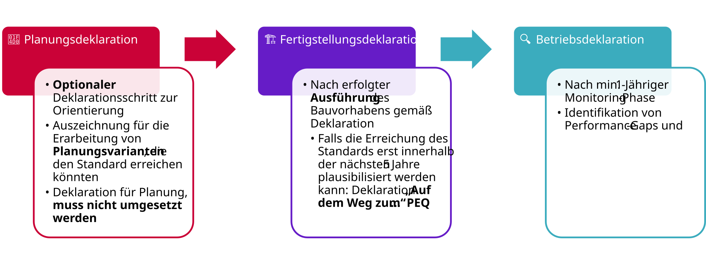
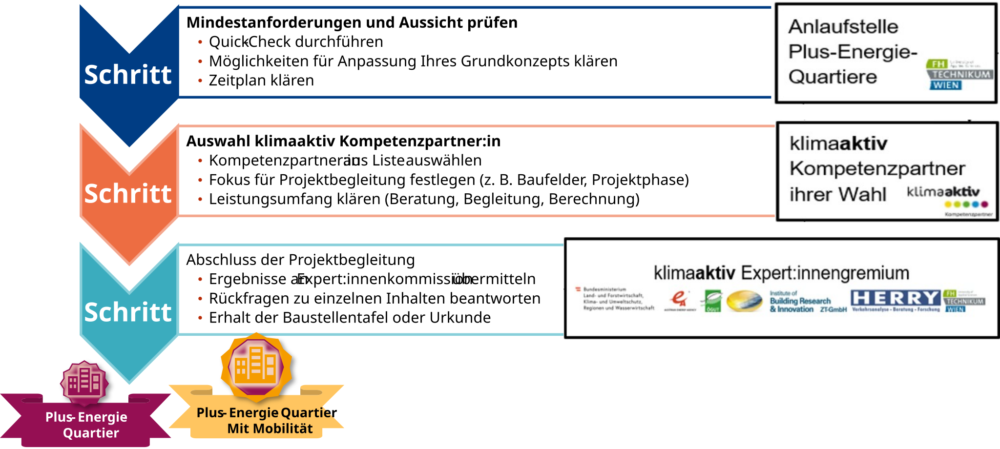
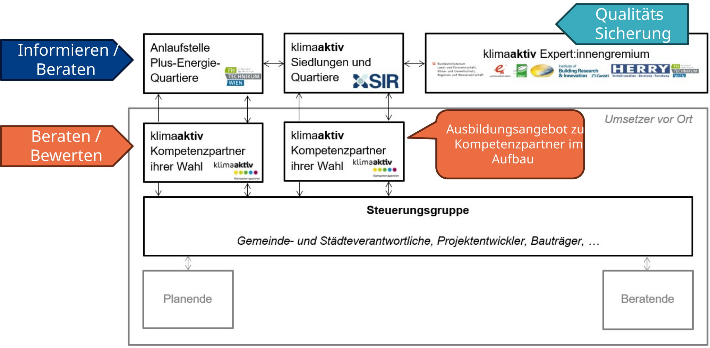

::: {.lead}
Vom untersuchten Konzept über die realisierte Lösung bis zum nachgewiesenen Betrieb
:::

Der klimaaktiv Standard kann in unterschiedlichen Projektphasen angewendet werden. Dabei sind zwei Fragen zu unterscheiden: **Welche Qualitätsstufe wird rechnerisch erreicht?** Und **wie belastbar ist der zugrunde liegende Projektstand?** Die Qualitätsstufen beschreibt [Der Standard](research.qmd); die Deklarationsphase kennzeichnet den Stand der Nachweisführung.

## Drei Deklarationsphasen

Die Nachweisführung kann in der Planung, nach Fertigstellung sowie auf Grundlage gemessener Betriebsdaten erfolgen. Mit fortschreitendem Projektstand verändert sich die Datengrundlage und damit die Aussagekraft der Deklaration.

{#fig-deklarationsphasen width="100%"}

### 📐 Planungsdeklaration – Potenziale und Varianten nachweisen

Eine **Planungsdeklaration** zeichnet die fundierte Untersuchung eines Quartierskonzepts aus. Sie zeigt, **unter welchen planerischen, technischen und organisatorischen Voraussetzungen** eine angestrebte Qualitätsstufe erreicht werden könnte. Insbesondere in frühen Phasen ermöglicht sie die Beantwortung von *Was-wäre-wenn-Fragen*: Welche PV-Flächen wären erforderlich? Welche Wärmeversorgung oder Mobilitätsmaßnahmen würden den Ausschlag geben? Wie stark beeinflussen unterschiedliche Bauweisen die THG-Bilanz?

Die betrachtete Variante **muss nicht später genau so umgesetzt werden**. Eine Planungsdeklaration ist daher weder eine Ausführungsverpflichtung noch ein Nachweis der später tatsächlich erreichten Performance. Entscheidend sind eine ausreichend detaillierte, nachvollziehbare Untersuchung sowie die transparente Kennzeichnung der zugrunde liegenden Annahmen und Abhängigkeiten.

### 🏗️ Fertigstellungsdeklaration – Umsetzung überprüfen

Die **Fertigstellungsdeklaration** bewertet das **tatsächlich errichtete beziehungsweise sanierte Quartier**. Die in der Planung angesetzten Maßnahmen werden mit dem Ausführungsstand abgeglichen: etwa Gebäudehülle, installierte Wärmeerzeugung, tatsächlich verfügbare PV-Flächen und -Leistungen, Speicher, Ladeinfrastruktur sowie realisierte Mobilitätsangebote.

Abweichungen von früheren Varianten sind zu dokumentieren und, soweit bilanzrelevant, neu zu bewerten. Maßgeblich ist die nachvollziehbar belegte Ausführung und die daraus berechnete Zielerreichung – nicht allein das ursprüngliche Planungsergebnis.

### 🔍 Betriebs- bzw. Monitoringdeklaration – Wirkung im Betrieb belegen

Die **Betriebsdeklaration** ergänzt die modellbasierte Bewertung um **gemessene Betriebsdaten** aus einer mindestens einjährigen Monitoringphase. Insbesondere Energiebezug, Erzeugung und Einspeisung sowie – soweit erfassbar und für die gewählte Qualitätsstufe relevant – weitere Energieflüsse und Nutzungsbedingungen werden mit den Annahmen der Bewertung abgeglichen.

Eine sachgerechte Interpretation berücksichtigt unter anderem Wetter, Belegung, Nutzungsänderungen und die Verfügbarkeit der technischen Anlagen. Das Monitoring ermöglicht es, Abweichungen zwischen prognostizierter und tatsächlicher Performance zu erkennen. Es ersetzt jedoch nicht die Bilanzierung jener Lebenszyklus- oder Mobilitätsemissionen, die nicht unmittelbar gemessen werden können.

| Phase | Bewertungsgrundlage | Aussage der Deklaration |
|---|---|---|
| 📐 **Planung** | Quartierskonzept, Fachannahmen und untersuchte Varianten | Unter welchen Bedingungen eine Qualitätsstufe erreichbar ist |
| 🏗️ **Fertigstellung** | Nachgewiesene Ausführung und aktualisierte Berechnung | Ob das ausgeführte Projekt die Anforderungen erfüllt |
| 🔍 **Betrieb / Monitoring** | Messdaten und dokumentierte Betriebsbedingungen | Inwieweit die prognostizierte Performance im Betrieb bestätigt wird |

: Bewertungsgrundlagen und Aussagekraft der Deklarationsphasen. {#tbl-deklarationsphasen}

::: {.callout-warning appearance="simple" icon=true title="Qualitätsstufe ist nicht Deklarationsphase"}

Die **Qualitätsstufe** bezeichnet den Umfang der erfüllten Energie- und THG-Anforderungen. Die **Deklarationsphase** beschreibt, ob die Beurteilung auf Planungsannahmen, der realisierten Ausführung oder gemessenen Betriebsdaten beruht. Beide Angaben sind unabhängig voneinander und müssen gemeinsam ausgewiesen werden.

:::

## 🧭 „Auf dem Weg“ – Zielerreichung in Etappen

Nicht jedes Quartier erfüllt bereits **zum Nachweiszeitpunkt** sämtliche Anforderungen einer angestrebten Qualitätsstufe. Vor allem im Bestand oder bei abschnittsweiser Entwicklung können wesentliche Maßnahmen erst später wirksam werden.

Die Deklaration **„Auf dem Weg zum Plus-Energie-Quartier“** berücksichtigt solche Entwicklungspfade, sofern eine spätere Zielerreichung innerhalb des vorgesehenen Zeitraums plausibel nachgewiesen werden kann. Das Konzept sieht hierfür einen Zeitraum von bis zu fünf Jahren vor.

Entscheidend ist die Unterscheidung zwischen einer allgemeinen Absicht und einem **technisch sowie zeitlich glaubhaften Umsetzungspfad**. Geeignete Nachweise können insbesondere sein:

- **PV-Vorhalteflächen:** planerisch gesicherte Dach- oder Fassadenflächen einschließlich Tragfähigkeit, Verschattung, Leitungsführung und künftiger Anschlussmöglichkeit.
- **Vorbereitete Energieflexibilität:** Mess-, Steuer- und Kommunikationsinfrastruktur sowie ein umsetzbares Regelungskonzept.
- **Technische Vorhaltungen:** Leerrohre, Platzreserven, Trassen oder elektrische Anschlussreserven für einen späteren Ausbau.
- **Nachvollziehbare Etappen:** konkrete Maßnahmen, Verantwortlichkeiten, Voraussetzungen und Zeitpunkte der Umsetzung.

Ein solcher Pfad ist **kein Nachweis einer bereits erreichten Qualitätsstufe**. Der aktuelle Zustand und die angestrebte vollständige Zielerreichung müssen getrennt dargestellt werden.

Für die THG-Bewertung sind außerdem die Emissionen bis zur späteren Umsetzung und die zusätzlichen Herstellungsemissionen der Maßnahmen zu berücksichtigen. Ein zukünftiges gutes Ergebnis macht bereits entstandene Emissionen nicht rückgängig.

Die Bewertung von Sanierung und Lebenszyklus wird unter [Ökobilanz](climate.qmd) erläutert.

::: {.callout-note appearance="minimal" icon=false title="Methodische Einordnung"}

Die verbindlichen Bedingungen für eine Deklaration „Auf dem Weg“, insbesondere Fristen, erforderliche Nachweise und die Zuordnung zur Qualitätsstufe, richten sich nach den jeweils gültigen Deklarationsvorgaben.

:::

## Ablauf der Nachweisführung

Der Weg zur klimaaktiv Auszeichnung wird durch ein Netzwerk aus Anlaufstelle, Kompetenzpartner:innen und Expert:innengremium begleitet. Der Ablauf lässt sich aus Sicht der Projektverantwortlichen in drei Schritte gliedern.

{#fig-weg-zum-peq width="100%"}

### Schritt 1 – Mindestanforderungen und Aussichten prüfen

Zu Beginn werden die grundsätzlichen Voraussetzungen des Vorhabens und die Aussichten auf eine erfolgreiche Deklaration geklärt. Ein **PEQ-Quick-Check** kann eine erste Einschätzung ermöglichen.

Dabei werden mögliche Anpassungen des Projektkonzepts, offene Anforderungen und ein geeigneter Zeitplan besprochen. Für diese erste Orientierung steht die **Anlaufstelle Plus-Energie-Quartiere** zur Verfügung.

### Schritt 2 – Kompetenzpartner:in auswählen

Für die vertiefte Bearbeitung können Projektverantwortliche eine:n **klimaaktiv Kompetenzpartner:in** auswählen.

Gemeinsam werden der Projektumfang, die Bilanzgrenzen, die untersuchten Varianten und der Leistungsumfang der Begleitung festgelegt. Dazu gehören gegebenenfalls die Datenerhebung, Berechnung, fachliche Beratung und Vorbereitung der Deklarationsunterlagen.

Die Kompetenzpartner:innen unterstützen die Anwendung des Standards und die nachvollziehbare Aufbereitung der erforderlichen Nachweise.

### Schritt 3 – Einreichung und Qualitätssicherung

Nach Abschluss der Projektbegleitung werden die erforderlichen Ergebnisse und Unterlagen zur fachlichen Prüfung übermittelt.

Das **klimaaktiv Expert:innengremium** prüft die Nachweisführung und kann Rückfragen zu einzelnen Annahmen, Berechnungen oder Belegen stellen. Nach erfolgreicher Prüfung erfolgt die entsprechende Deklaration beziehungsweise Auszeichnung.

Die Qualitätssicherung dient insbesondere der fachlichen Plausibilisierung, Nachvollziehbarkeit und einheitlichen Anwendung des Standards.

## Akteure und Zuständigkeiten

Die Nachweisführung ist in die Organisationsstruktur des klimaaktiv Programms für Siedlungen und Quartiere eingebettet. Die beteiligten Akteure übernehmen unterschiedliche, aufeinander abgestimmte Aufgaben.

{#fig-programmteam width="100%"}

Die wesentlichen Rollen sind:

- **Anlaufstelle Plus-Energie-Quartiere:** Erstinformation, Beratung zur grundsätzlichen Anwendbarkeit des Standards und Unterstützung bei Fragen zur Nachweisführung.
- **klimaaktiv Siedlungen und Quartiere:** Programmkoordination und Unterstützung der entsprechenden Qualitätssicherungs- und Beratungsstrukturen.
- **klimaaktiv Kompetenzpartner:innen:** Projektbezogene Beratung, Bewertung und Unterstützung bei der Erarbeitung der Nachweisunterlagen.
- **klimaaktiv Expert:innengremium:** Fachliche Qualitätssicherung und Prüfung der eingereichten Ergebnisse.
- **Projektverantwortliche und Fachplanende:** Erarbeitung des Projekts, Bereitstellung der notwendigen Daten, Umsetzung der Maßnahmen und Dokumentation der Nachweise.

Die Zusammenarbeit zwischen den beteiligten Stellen soll eine nachvollziehbare Bewertung ermöglichen, ohne die Verantwortlichkeiten für Projektplanung, Berechnung und Qualitätssicherung zu vermischen.

## Anforderungen an Datenqualität und Nachvollziehbarkeit

Die Nachweisführung bündelt Angaben aus Architektur, Bauphysik, Haustechnik, Mobilitätsplanung und Ökobilanz. Für ergebnisrelevante Eingaben ist zu kennzeichnen, ob es sich um **Referenzannahmen**, **projektspezifische Berechnungen**, **bestätigte Ausführungsangaben** oder **Messwerte** handelt. Abhängigkeiten von nicht gesicherten Maßnahmen sind sichtbar auszuweisen.

Für Variantenvergleiche sind Quartiersabgrenzung, Nutzungsumfang, Flächenbezüge und Bewertungsstand konsistent zu halten. Werden sie verändert, muss die Auswirkung auf Bedarf, Kontextfaktoren und zugeteilte Budgets kenntlich gemacht werden.

