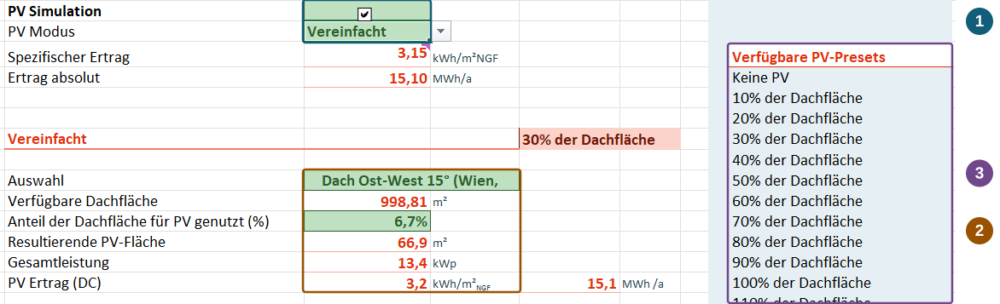
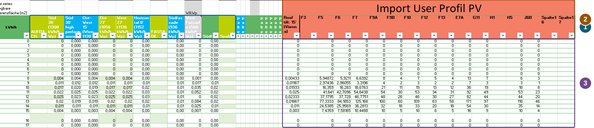

Wie viel deiner lokalen PV-Erzeugung kann das Quartier selbst nutzen? PEExcel verknüpft das stündliche Erzeugungsprofil mit Strombedarf, Speicherladung und Netzeinspeisung. So lässt sich untersuchen, wie sich Anlagengröße und zeitlicher Verlauf auf die Versorgung auswirken. Für den Einstieg kannst du die PV vereinfacht über die Dachfläche dimensionieren. Für ein konkretes Anlagenkonzept verwendest du ein eigenes, extern simuliertes Erzeugungsprofil.

::: {.excel-operation}
**Wo findest du die Funktionen?** Im Blatt [🌞 PV]{.excel-menu .darkred} ("Photovoltaik") wählst und dimensionierst du die Anlage. Eigene Stundenprofile hinterlegst du im Blatt [PV-Import]{.excel-menu .darkred}. Die Schnellauswahl erreichst du auch über das Menüband **klimaaktiv PEQ**.
:::

## Vereinfachte Eingabe: Dachflächen-Skalierung {#dachflaechen-skalierung}

Wähle im Feld [PV Modus]{.excel-field} die Einstellung **Vereinfacht**. Wähle anschließend das passende Erzeugungsprofil, beispielsweise eine Ost-West-Anlage. Die verfügbare Dachfläche und der für PV genutzte Anteil bestimmen die Dimensionierung. Kontrolliere danach die resultierende PV-Fläche, die Gesamtleistung und den Ertrag.

{#fig-pv-skalierung fig-alt="Ausschnitt des PV-Blatts mit drei markierten Bereichen: PV-Simulation und Modus, Profilauswahl mit Flächen und Gesamtleistung sowie Liste der PV-Presets."}

1. **Modus wählen:** Über die PV-Simulation und den Modus legst du fest, wie die Erzeugung angesetzt wird.
2. **Dimensionierung prüfen:** Das gewählte Profil beschreibt den zeitlichen Verlauf. Der angesetzte Dachflächenanteil skaliert die Anlage; die Felder darunter zeigen die resultierende Fläche, Leistung und den Ertrag. Maßgeblich sind die aktuellen Eingabewerte. Eine zuvor gewählte Preset-Bezeichnung kann nach manuellen Änderungen vom eingestellten Anteil abweichen, wie im Screenshot zu sehen.
3. **Schnell einsteigen:** Presets erleichtern den Vergleich verschiedener Dachflächenanteile. Du kannst mit einer Vorgabe starten und die Eingaben anschließend an dein Projekt anpassen.

Berechne die Variante neu und prüfe im [Ergebnisblatt](results.qmd#endenergiebilanz), wie viel PV-Strom direkt genutzt, gespeichert oder eingespeist wird. Ein größerer Jahresertrag allein sagt noch nicht, ob die zusätzliche Erzeugung zeitlich zum Bedarf passt.

## Detaillierte Eingabe: stündliches Erzeugungsprofil {#profilimport}

Wenn die Anlage projektspezifisch simuliert wurde, kannst du ihr Stundenprofil übernehmen. Dokumentiere dazu Standort, Ausrichtung, installierte Leistung und bereits berücksichtigte Verluste. Im Blatt **PV-Import** stehen Standardprofile und ein eigener Bereich **Import User Profil PV** nebeneinander.

{#fig-pv-profile fig-alt="Ausschnitt von PV-Import. Links sind Standardprofile, rechts ist der orange Bereich Import User Profil PV mit Profilnamen und Stundenwerten markiert."}

1. **Vorhandene Profile:** Die linke Gruppe enthält bereits hinterlegte Profile für unterschiedliche Ausrichtungen und Anlagenarten.
2. **Eigene Profile benennen:** Verwende die Spalten im orange gekennzeichneten Bereich für deine eigenen Profile und gib ihnen eindeutige Namen.
3. **Stundenwerte hinterlegen:** Übernimm die Jahresreihe mit 8.760 Stunden in die zugehörige Spalte. Der Ausschnitt zeigt nur die ersten Stunden. Prüfe Einheit und Zeitbezug: Eine mittlere Stundenleistung in kW entspricht bei genau einer Stunde numerisch der Energie in kWh dieses Intervalls. Normierte und absolute Profile müssen entsprechend ihrer Bezugsleistung behandelt werden.

Wähle das hinterlegte Profil anschließend im PV-Blatt aus und kontrolliere Skalierung und Verlustfaktoren. Verluste, die bereits in der externen Simulation berücksichtigt wurden, dürfen nicht erneut abgezogen werden. Wetter- und PV-Zeitreihe müssen zeitlich zusammenpassen; fehlende Stunden oder abweichende Kalender müssen vor der Übernahme geklärt werden.

Berechne die Variante neu. Vergleiche die Jahressumme und typische Tagesverläufe im [Excel-Dashboard](excel-dashboard.qmd) mit der externen PV-Simulation. Damit prüfst du sowohl die Größenordnung als auch die zeitliche Zuordnung der Erzeugung.

Die Bedienansichten stammen aus einer bereitgestellten Entwicklungsfassung und zeigen Beispielwerte. Zum Vergrößern kannst du die Bilder anklicken.[^pv]

[Wetterdaten](interfaces.qmd#wetter) · [Speicher und Flexibilität](systems.qmd) · [PV-LCA und Bewertungsgrenze](climate.qmd)

[^pv]: Bedienansichten und Erläuterungen des Projektteams; ergänzend [PEExcel-Schulung, Folien 9, 15 und 31](downloads/schulung.pdf#page=31).
